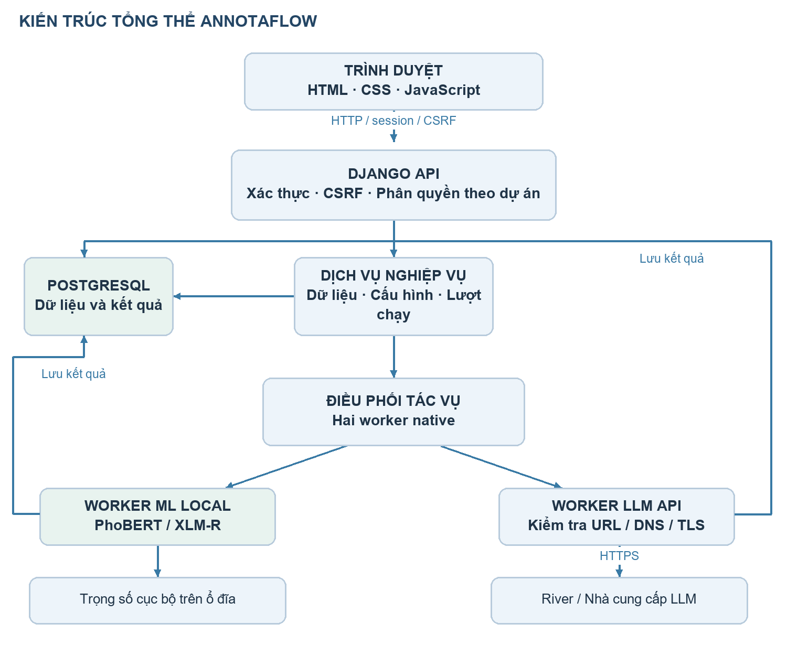
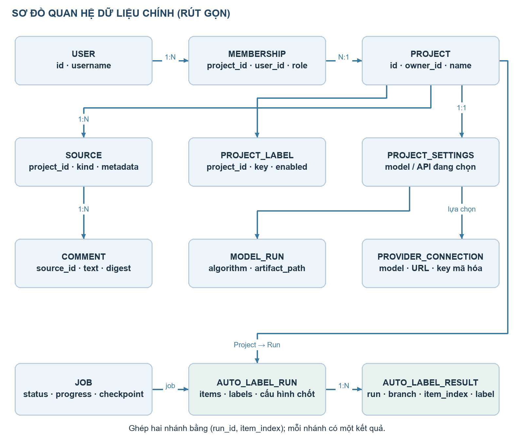
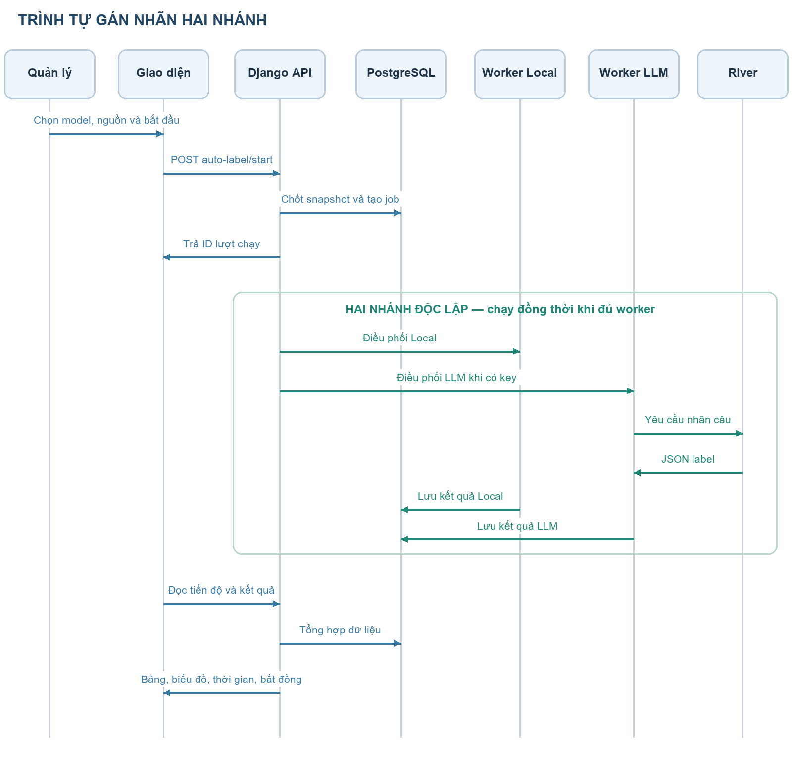

# BÁO CÁO TỔNG HỢP ĐỒ ÁN ANNOTAFLOW

Website tự động gán nhãn bình luận tiếng Việt bằng ML Local và LLM qua API

Ngày lập: 25/10/2026. Phạm vi: mã nguồn và dữ liệu hiện có tại nhánh huong-moi, bao gồm thay đổi đang có trong workspace. Tài liệu không thay thế biên bản nghiệm thu hoặc xác nhận nguồn gốc một lần huấn luyện lịch sử.

## 1. Tổng quan và kết quả đã thực hiện

### 1.1. Bài toán và mục tiêu

Bình luận trên mạng xã hội có thể chứa lời lẽ độc hại, xúc phạm hoặc công kích. Việc đọc và gán nhãn từng bình luận bằng tay tốn thời gian, trong khi kết quả của một mô hình vẫn có thể sai do ngữ cảnh, tiếng lóng hoặc mỉa mai. AnnotaFlow tổ chức dữ liệu theo dự án, tự gán nhãn bằng mô hình cục bộ và có thể chạy thêm LLM qua API để đối chiếu kết quả.

Đầu vào là bình luận nhập từ văn bản, CSV hoặc thu thập từ YouTube. Đầu ra là nhãn, các đoạn độc hại do ML Local dự đoán, thống kê phân bố, thời gian xử lý và danh sách bình luận khác nhãn giữa hai nhánh. Hai nhãn câu đang dùng với bộ model ViHOS là NON_TOXIC — Không độc hại và TOXIC — Độc hại.

Điểm chính của đồ án là tích hợp một quy trình làm việc có lưu vết: quản lý dữ liệu → chốt đầu vào → chạy một hoặc hai nhánh → lưu kết quả → thống kê và so sánh. Mục tiêu không phải khẳng định LLM hoặc ML luôn đúng, cũng không phải tự động xử phạt người viết bình luận.

### 1.2. Các kết quả đã làm được

| Nhóm | Kết quả hiện có | Giới hạn cần trình bày |
|---|---|---|
| Tài khoản | Đăng nhập, đăng xuất, đăng ký, quản lý phiên; có luồng đổi/khôi phục mật khẩu và xác minh email | Gửi email thật cần cấu hình SMTP; local có thể ghi email ra file |
| Dự án | Tạo/chuyển dự án, thành viên và vai trò, bộ nhãn, hướng dẫn, khóa/lưu trữ | Quyền được kiểm tra lại tại backend |
| Dữ liệu | Nhập văn bản/CSV, ánh xạ cột; thu thập bình luận YouTube; tìm kiếm, phân trang, quản lý nguồn | YouTube cần API key và phụ thuộc quota/dữ liệu công khai |
| ML Local | Nạp ba bộ trọng số PhoBERT-base, XLM-R base, XLM-R large; chọn một model cho một lượt | Không phải cả ba model cùng chạy trong một lượt; CPU có thể chậm với model large |
| LLM API | Cấu hình nhà cung cấp, model mặc định, khóa server; gọi API từ backend | Tốc độ, chi phí và khả dụng phụ thuộc nhà cung cấp |
| Tự gán nhãn | Luôn có nhánh Local; có thêm LLM khi kết nối API đủ điều kiện; cùng snapshot dữ liệu và bộ nhãn | Số kết quả tạm thời có thể khác vì tốc độ hoặc lỗi |
| Kết quả | Biểu đồ tỷ lệ nhãn, danh sách, tiến độ, thời gian tổng và trung bình từng nhánh | Tỷ lệ nhãn là mô tả đầu ra, không phải độ chính xác |
| So sánh | Lọc bình luận khác nhãn; chỉ so trên mẫu đã có đủ hai kết quả | Bất đồng là tín hiệu xem lại, chưa xác định bên đúng |
| Phục hồi | Dừng/tiếp tục, lưu kết quả theo từng mẫu, tiếp tục mẫu còn thiếu | Native dùng worker trong tiến trình, chưa phải hàng đợi production bền vững |
| Xuất và cài đặt | Xuất CSV kết quả; quản lý nhà cung cấp; xem/tải cấu hình JSON đã loại bí mật; xóa dự án có xác nhận và kiểm quyền | Kiểm tra kết nối metadata không chứng minh chất lượng gán nhãn |
| UI/UX | Thống nhất màu navy–xanh, thẻ/form/nút; sửa bố cục hẹp và checkbox; responsive | Kiểm tra UI bằng fixture cục bộ, không thay thế kiểm thử người dùng thực tế |
| Hồ sơ ML | Dataset gốc, mã train/evaluate, cấu hình ba model, báo cáo nhập và manifest hash | Hồ sơ nhập không tự chứng minh lần train lịch sử trên máy hiện tại |

Mã và dữ liệu của luồng gán nhãn thủ công, gold, phiên bản dữ liệu và một số chức năng nghiên cứu cũ vẫn được giữ. Tuy nhiên, nhánh giao diện chính hiện tập trung vào tự gán nhãn; không nên trình bày toàn bộ chức năng cũ như một quy trình đang được sử dụng đầy đủ.

### 1.3. Phân biệt trạng thái triển khai và bằng chứng

Chức năng hiện có được xác định từ mã nguồn backend, frontend và mô hình dữ liệu. Điểm F1 trong báo cáo lấy từ các tệp metrics.json đã cung cấp, không phải phép đo mới trong lần viết tài liệu này. Các số 115 bình luận hoặc thời gian từng lượt trên màn hình là dữ liệu của lượt chạy cụ thể, không phải benchmark cố định.

Đợt chỉnh UI gần nhất đã đối chiếu 13 màn hình/trạng thái ở các chiều rộng 1440, 1024 và 390 px, tổng cộng 39 trường hợp; giữ nguyên danh sách nút và trường nhập, không còn tràn ngang toàn trang trong các trường hợp đó. Kiểm tra cú pháp JavaScript và 16 bộ chuyển đổi xuất dữ liệu đã đạt. Không suy rộng kết quả này thành cam kết không có lỗi hoặc đã kiểm thử tải production. Workflow CI có ma trận PostgreSQL 15–18, nhưng cấu hình workflow không tự chứng minh mọi lần chạy đều xanh.

## 2. Phân tích yêu cầu chức năng và phi chức năng

### 2.1. Tác nhân và phân quyền

| Tác nhân | Nhiệm vụ và quyền |
|---|---|
| Người chưa đăng nhập | Đăng ký, đăng nhập và khôi phục tài khoản |
| Thành viên dự án | Xem dữ liệu và kết quả theo quyền trong dự án đã tham gia |
| Quản lý dự án | Quản lý dữ liệu, thành viên theo quyền; cấu hình model/API; điều khiển lượt gán nhãn |
| Chủ dự án | Quyền quản lý và quyền xóa vĩnh viễn dự án sau xác nhận |
| Dịch vụ bên ngoài | YouTube cung cấp bình luận; nhà cung cấp LLM nhận yêu cầu và trả kết quả |

Vai trò quản lý dự án thuộc Membership.role và quan hệ sở hữu Project.owner; không đồng nghĩa người dùng phải là Django superuser. Frontend có thể ẩn thao tác, nhưng backend mới là nơi quyết định quyền.

### 2.2. Yêu cầu chức năng

| Mã | Chức năng | Điều kiện/kết quả chính |
|---|---|---|
| FR01 | Xác thực và quản lý tài khoản | Các API nghiệp vụ yêu cầu phiên hợp lệ |
| FR02 | Quản lý dự án/thành viên | Phân tách dữ liệu và quyền theo dự án |
| FR03 | Nhập dữ liệu | Tạo Source và Comment; kiểm tra dữ liệu, xử lý trùng theo cơ chế hiện có |
| FR04 | Thu thập YouTube | Lưu bình luận, phản hồi và tiến độ; có điều kiện tiếp tục |
| FR05 | Chọn model Local | Model thuộc dự án, sẵn sàng và hỗ trợ bộ nhãn đang bật |
| FR06 | Quản lý API | Thêm/sửa/tắt; chọn nhà cung cấp và model mặc định; khóa rỗng khi sửa giữ khóa cũ |
| FR07 | Kiểm tra kết nối | Backend gọi metadata/danh sách model; phân biệt lỗi và không giả thành công |
| FR08 | Tạo lượt tự gán nhãn | Chốt tập bình luận, nhãn, model và cấu hình API trước khi chạy |
| FR09 | Chạy độc lập hai nhánh | Local hoạt động khi không có API; lỗi LLM không tự hủy Local |
| FR10 | Lưu và theo dõi kết quả | Trạng thái, tiến độ, nhãn, spans Local và thời gian được lưu |
| FR11 | Thống kê và so sánh | Phần trăm theo từng nhánh; bất đồng trên tập đã có đủ hai kết quả |
| FR12 | Dừng và tiếp tục | Giữ kết quả đã lưu, bỏ qua mẫu đã hoàn thành khi tiếp tục |
| FR13 | Xuất kết quả/cấu hình | CSV kết quả; JSON cấu hình không chứa bí mật |
| FR14 | Xóa dự án | Chủ dự án xác nhận đúng tên; kiểm tra tác vụ đang chạy theo backend |

### 2.3. Yêu cầu phi chức năng

| Nhóm | Cơ chế/định hướng hiện tại | Cách đánh giá phù hợp |
|---|---|---|
| Bảo mật | Session/CSRF, phân quyền server, key mã hóa, kiểm tra đích API | Test người không có quyền, response không lộ key, URL nội bộ bị từ chối |
| Toàn vẹn | Giao dịch DB, snapshot, ràng buộc kết quả duy nhất | Retry không tạo hai kết quả cho cùng mẫu/nhánh |
| Khả năng phục hồi | Checkpoint và kết quả từng mẫu | Dừng sau một phần dữ liệu rồi tiếp tục không mất phần đã lưu |
| Hiệu năng | Tác vụ nền, cache một model Local, theo dõi thời gian | Đo cold/warm start, p50/p95, RAM và throughput trên máy được công bố |
| Khả năng sử dụng | Tiếng Việt, responsive, trạng thái rõ ràng, bảng có vùng cuộn | Thử desktop/mobile; kiểm tra thao tác và khả năng đọc |
| Khả năng bảo trì | Tách UI/API/job/adapter/model dữ liệu; migrations | Thay nhà cung cấp mà không viết lại màn hình nghiệp vụ |
| Khả năng tái lập | Cấu hình train, seed, hash dữ liệu/source, wrapper ghi manifest | Chạy thật từ commit đã lưu và giữ stdout, cấu hình, trọng số, metrics |
| Khả năng mở rộng | Có lựa chọn Celery/Redis trong Docker | Cần benchmark riêng trước khi cam kết nhiều người dùng đồng thời |

Đồ án chưa có số liệu xác nhận SLA, độ sẵn sàng cao, khả năng chịu tải lớn hoặc chứng nhận bảo mật. Đây là các tiêu chí cần đo và hoàn thiện, không phải các kết quả đã đạt chỉ nhờ chọn công nghệ.

## 3. Cấu trúc hệ thống và thiết kế kiến trúc

### 3.1. Công nghệ và mô hình kiến trúc

Frontend dùng HTML, CSS và JavaScript ES modules, điều hướng bằng URL hash. Backend là Django 5.2, chia module theo nghiệp vụ và cung cấp API JSON/CSV. PostgreSQL lưu dữ liệu nghiệp vụ. PyTorch và Transformers thực hiện suy luận token classification. Không có React/Vue trong frontend hiện tại.

Ở chế độ Windows native, một dịch vụ Django tại 127.0.0.1:8000 phục vụ cả giao diện và API; PostgreSQL chạy riêng. Tác vụ nền dùng ThreadPoolExecutor với hai worker trong tiến trình. Phương án Docker có web, Celery worker, Redis và PostgreSQL; không nên nhầm có cấu hình triển khai với đã kiểm chứng production.

### 3.2. Trách nhiệm các thành phần

| Thành phần | Vị trí | Trách nhiệm |
|---|---|---|
| Giao diện nguồn | frontend/src/features/ | Các màn hình dự án, dữ liệu, tự gán nhãn, model/API, xuất dữ liệu |
| Thành phần dùng chung | frontend/src/core/ | API client, state, modal, nút, helper giao diện |
| Điều hướng/giao diện chung | frontend/src/app.js và styles/ | Shell, router, sự kiện; visual-refresh.css là lớp nâng cấp trình bày |
| Cấu hình Django | backend/config/ | Settings, URL gốc, WSGI, Celery |
| Dữ liệu và tác vụ lõi | backend/core/ | Project, Membership, Source, Comment, Job, audit; nhập liệu và suy luận |
| Nghiệp vụ giao diện | backend/studio/ | Bộ nhãn/cài đặt dự án, AutoLabelRun, AutoLabelResult, API kết quả |
| Tích hợp API | backend/integrations/ | ProviderConnection, adapter, key mã hóa, kiểm tra kết nối và SSRF |
| Hồ sơ model | backend/experiments/ | ModelRun, artifact_path và báo cáo; có cơ chế thí nghiệm cũ |
| Trọng số | backend/artifacts/transformers/vihos-full/ | Ba thư mục phobert-base, xlmr-base, xlmr-large |
| Dataset | datasets/ViHOS/data/ | Năm CSV train/dev/test nguyên bản được nhập |
| Train và bằng chứng | training/ và notebooks/training/ | Script train/eval, cấu hình, hồ sơ nhập, wrapper thực nghiệm và notebook |
| Triển khai/kiểm thử | scripts/, requirements/, backend/tests/, .github/workflows/ | Build, setup Windows, dependencies và kiểm thử |
| Tài liệu/output | docs/ và dist/ | Tài liệu báo cáo; dist là frontend được sinh, không phải nơi sửa nguồn chính |

Chuỗi build giao diện: sửa frontend → chạy scripts/build_frontend.py → tạo dist. Các tệp .env.local, private_data, môi trường .venv và trọng số lớn là tài nguyên riêng/runtime; không gộp thành mã nguồn nghiệp vụ hoặc công khai bí mật lên Git.

### 3.3. Thiết kế cơ sở dữ liệu

| Thực thể/bảng chính | Vai trò | Quan hệ nổi bật |
|---|---|---|
| User, core_project | Tài khoản, dự án và chủ dự án | Một người có thể sở hữu nhiều dự án |
| core_membership | Người tham gia và vai trò | Nối người dùng với dự án |
| core_source, core_comment | Nguồn nhập và bình luận | Dự án có nhiều nguồn; nguồn có nhiều bình luận |
| studio_projectsettings, studio_projectlabel | Cấu hình và bộ nhãn | Một bộ cài đặt/dự án, nhiều nhãn/dự án |
| experiments_modelrun | Phiên bản model, thuật toán, đường dẫn và report | Model được đăng ký theo dự án |
| integrations_providerconnection | Nhà cung cấp, model, key mã hóa và trạng thái | Cấu hình API theo dự án |
| core_job | Trạng thái và checkpoint công việc | Hai nhánh có job độc lập |
| studio_autolabelrun | Snapshot items/labels/model_config/connection_config | Thuộc dự án; tham chiếu job Local và job LLM nếu có |
| studio_autolabelresult | Nhãn, spans, latency, token/chi phí từng mẫu/nhánh | Duy nhất theo run + branch + item_index |
| core_auditevent | Nhật ký thao tác | Gắn tác nhân, dự án và thời điểm |

Quan hệ ổn định dùng khóa ngoại. Đầu vào của lượt tự gán nhãn dùng JSON snapshot để lưu đúng tập dữ liệu và điều kiện của lượt đó. Đổi tên nguồn, nhập thêm bình luận hoặc đổi model hiện tại không được làm kết quả cũ tự biến thành một thực nghiệm mới.

CSV ViHOS nằm trên ổ đĩa phục vụ train/evaluate; PostgreSQL chứa tài khoản, dự án, bình luận người dùng và các lượt chạy. Trọng số safetensors nằm trong thư mục artifact, còn database lưu đường dẫn và metadata. Không nên gọi một tệp CSV dataset là toàn bộ CSDL của website.

### 3.4. Luồng tự gán nhãn và quy tắc nghiệp vụ

1. Người quản lý chọn dự án, nguồn bình luận và model Local đang sẵn sàng. Backend kiểm tra quyền, trạng thái khóa/lưu trữ và bộ nhãn hỗ trợ.
2. Backend chốt items, labels và cấu hình vào AutoLabelRun. Tạo job Local, đồng thời tạo job LLM nếu có kết nối được bật và đủ thông tin.
3. Sau khi giao dịch tạo lượt hoàn tất, bộ điều phối đưa job vào worker. Hai nhánh xử lý độc lập khi có worker rảnh; không phải tất cả bình luận đều được gửi đồng thời.
4. Local nạp model/tokenizer, dự đoán BIO và chuyển thành spans/nhãn câu. LLM nhận văn bản và định nghĩa cùng bộ nhãn, trả JSON nhãn câu.
5. Backend xác thực kết quả, lưu từng AutoLabelResult rồi cập nhật checkpoint. Lỗi một nhánh vẫn giữ kết quả đã lưu và không tự hủy nhánh còn lại.
6. Frontend đọc tiến độ/kết quả, dựng biểu đồ và danh sách. Ghép hai nhánh bằng item_index trong cùng lượt; không ghép theo vị trí dòng sau lọc hoặc theo văn bản tùy ý.
7. Khi tiếp tục, worker bỏ qua các mẫu đã có kết quả. Nếu trọng số hoặc cấu hình API không còn khớp điều kiện chốt, yêu cầu tạo lượt mới để tránh trộn kết quả.

### 3.5. Thiết kế thống kê và đo thời gian

Tỷ lệ một nhãn = số kết quả mang nhãn đó / số kết quả đã hoàn thành của chính nhánh × 100%. Nếu LLM mới xử lý 53/115 mẫu, biểu đồ LLM tính trên 53 mẫu, không coi 62 mẫu còn lại là không độc hại.

Tỷ lệ bất đồng = số mẫu Local và LLM khác nhãn / số mẫu đã có đủ hai kết quả × 100%. Chỉ so nhãn câu; khác span Local không được tự coi là bất đồng với LLM vì luồng API tự động hiện chỉ yêu cầu nhãn câu.

Tổng thời gian nhánh được đo bằng đồng hồ perf_counter, gồm chuẩn bị model/API, xử lý và lưu kết quả trong các khoảng chạy; không cộng thời gian đợi hàng hoặc thời gian dừng giữa các lần tiếp tục. Latency từng mẫu có phạm vi hẹp hơn. Vì vậy, tổng thời gian chia số mẫu không nhất thiết bằng trung bình latency mẫu. Khi một nhánh lỗi/chưa hoàn tất phải hiển thị trạng thái chưa đủ điều kiện so sánh cuối cùng.

### 3.6. Thiết kế bảo mật và trải nghiệm

API key gửi tới backend để lưu, không được trả ngược đầy đủ cho trình duyệt. ProviderConnection lưu key mã hóa bằng Fernet; khóa mã hóa hiện được dẫn xuất từ DJANGO_SECRET_KEY. Cần giữ bí mật này ổn định và có kế hoạch xoay khóa: thay SECRET_KEY có thể khiến key đã lưu không giải mã được.

Luồng cấu hình nhà cung cấp công khai yêu cầu HTTPS, kiểm tra URL và DNS, chặn IP nội bộ/metadata, ghim IP đã kiểm tra khi kết nối và giữ Host/TLS SNI đúng hostname. Không theo redirect tùy ý. Các cơ chế này giảm rủi ro SSRF nhưng vẫn cần kiểm thử và giám sát khi triển khai thật.

Kiểm tra kết nối dùng metadata/danh sách model từ backend, không tự gửi nội dung sinh có tính phí. Trạng thái xanh xác nhận lần kiểm tra metadata thành công tại thời điểm đó; không bảo đảm tài khoản còn quota, mọi model đều gọi được hoặc kết quả gán nhãn đúng.

Giao diện ưu tiên phân cấp tiêu đề, thông tin trạng thái và thao tác; bảng dài có vùng cuộn, nút được xuống hàng thay vì chồng nhau. Phần model/API giữ nền tối phối màu cùng hệ thống. Các nút và chức năng cũ được giữ trong đợt nâng cấp UI.

## 4. Dataset ViHOS và vai trò trong huấn luyện

### 4.1. Dataset là gì? Vì sao chọn ViHOS?

Dataset là tập ví dụ có cấu trúc phục vụ học và đánh giá mô hình. Với học có giám sát, mỗi ví dụ gồm đầu vào và nhãn chuẩn. Trong bài này đầu vào là bình luận tiếng Việt; nhãn chuẩn xác định các token/đoạn ký tự độc hại, chứ không chỉ một nhãn tổng quát cho cả câu.

ViHOS là Vietnamese Hate and Offensive Spans, gắn với công trình của Hoang và cộng sự tại EACL 2023 [1], mã/dữ liệu được công bố trong kho tác giả [2]. Lý do chọn: cùng ngôn ngữ và miền bình luận; có nhãn đoạn phù hợp token classification; có tập train/dev/test; cho phép kiểm tra ranh giới đoạn thay vì chỉ thấy một nhãn câu. Nguồn dữ liệu và hướng dẫn gán nhãn có thể được dẫn trong báo cáo.

Dataset công khai không có nghĩa nhóm tự thu thập hoặc tự gán nhãn toàn bộ. Đóng góp của đồ án là dùng/tích hợp, xây pipeline và ứng dụng. Khi phân phối lại cần giữ ghi nhận nguồn và tuân thủ điều kiện của dataset gốc. Không mặc định mọi bình luận YouTube hiện tại có cùng phân bố với ViHOS.

### 4.2. Quy mô và cách chia thực tế trong source

Đếm trực tiếp các CSV hiện có: tổng cộng 11.056 bình luận = 8.844 train + 1.106 dev + 1.106 test, xấp xỉ 80%/10%/10%. Hai cách biểu diễn Word và Syllable không phải hai tập bình luận độc lập; không cộng hai lần thành 22.112 mẫu.

| Tệp dưới datasets/ViHOS/data/ | Số dòng dữ liệu | Số bình luận | Mục đích |
|---|---|---|---|
| Sequence_labeling_based_version/Syllable/train_BIO_syllable.csv | 112.754 token | 8.844 | Huấn luyện bản syllable |
| Sequence_labeling_based_version/Syllable/dev_BIO_syllable.csv | 14.476 token | 1.106 | Validation bản syllable |
| Sequence_labeling_based_version/Word/train_BIO_Word.csv | 108.432 token | 8.844 | Huấn luyện bản word nếu cấu hình chọn word |
| Sequence_labeling_based_version/Word/dev_BIO_Word.csv | 13.948 token | 1.106 | Validation bản word |
| Test_data/test.csv | 1.106 bình luận | 1.106 | Đánh giá cuối bằng vị trí ký tự độc hại |

Dòng dữ liệu không gồm header. Các CSV BIO có một dòng cho một token và lặp sentence_id để gom lại thành câu; test có một dòng cho một bình luận. Vì vậy 112.754 dòng train không phải 112.754 bình luận.

### 4.3. Các cột và ý nghĩa

CSV train/dev BIO thực tế có 5 cột vật lý, trong đó 3 cột nghiệp vụ và 2 cột chỉ mục được giữ từ tệp nguồn.

| Cột trong CSV BIO | Ý nghĩa | Có đưa vào mô hình không? |
|---|---|---|
| Cột đầu không có tên | Chỉ mục dòng xuất kèm tệp; công cụ có thể hiện Unnamed: 0 | Không dùng làm đặc trưng |
| index | Cột chỉ mục bổ sung trong tệp nguồn | Bộ đọc hiện bỏ qua, không phải nhãn độc hại |
| Word | Chuỗi token, là âm tiết hoặc đơn vị từ tùy phiên bản | Đầu vào được tokenizer mã hóa thành input_ids |
| Tag | Nhãn O, B-T hoặc I-T của token | Nhãn giám sát để tính loss |
| sentence_id | ID để nhóm các dòng token thuộc cùng một câu | Dùng nhóm dữ liệu, không dùng như đặc trưng dự đoán |

CSV test có 3 cột vật lý: cột chỉ mục không tên, content và index_spans. Hai cột nghiệp vụ là content — bình luận đầy đủ và index_spans — danh sách vị trí ký tự độc hại theo chỉ số bắt đầu từ 0. Nó không phải danh sách cặp start/end sẵn có; mã đọc gom các chỉ số liên tiếp thành đoạn [start, end), với end không bao gồm.

Ví dụ giả lập, không trích dataset: content = “abc xyz”, index_spans = [4, 5, 6] nghĩa là “xyz” có span [4, 7). Chỉ số ký tự là vị trí trong chuỗi Unicode Python, không phải byte UTF-8.

### 4.4. Nhãn BIO và hai dạng token hóa

| Nhãn | Ý nghĩa | Ví dụ minh họa nhân tạo |
|---|---|---|
| O | Token nằm ngoài đoạn độc hại | Các token bình thường |
| B-T | Token bắt đầu một đoạn độc hại | Token đầu của một cụm bị đánh dấu |
| I-T | Token tiếp theo bên trong đoạn đó | Token thứ hai, thứ ba trong cùng cụm |

Syllable biểu diễn theo âm tiết; Word biểu diễn theo từ đã tách, có thể ghép các âm tiết trong một từ bằng dấu gạch dưới. Đây là đơn vị tiền xử lý; subword tokenizer của Transformer còn có thể chia một đơn vị thành nhiều mảnh nữa.

Cấu hình three_models.json và metrics nhập hiện đều ghi variant=syllable cho cả ba model, bao gồm PhoBERT. Không được viết rằng lần train PhoBERT hiện có đã dùng bản Word chỉ vì đó là cách thường được khuyến nghị. Hướng hoàn thiện là làm thí nghiệm PhoBERT với tách từ đúng khuyến nghị của tác giả [3], đồng bộ train–test–inference rồi so sánh trên dev.

### 4.5. Tác dụng train, dev và test

| Phần | Có cập nhật trọng số? | Dùng để làm gì? | Điều cần tránh |
|---|---|---|---|
| Train | Có | Tính loss, lan truyền ngược và cập nhật tham số từ ví dụ có nhãn | Không trộn dữ liệu dev/test vào train |
| Dev/validation | Không trong bước đánh giá | Theo dõi tổng quát hóa, chọn checkpoint và thử cấu hình | Không tối ưu vô hạn trên dev mà bỏ qua nguy cơ overfit dev |
| Test | Không | Đánh giá cuối mô hình/cấu hình đã chốt trên dữ liệu chưa dùng để chọn | Không chọn epoch/model bằng điểm test rồi gọi đó là kiểm tra độc lập |

Trong mã train, checkpoint được chọn theo dev span F1 partial tốt nhất; sau đó nạp lại checkpoint tốt nhất để đánh giá test nếu bật --test. Với PhoBERT và XLM-R large, trường dev_best trong báo cáo gốc lại được ghi từ epoch cuối, nên cần đọc best_dev_span_f1_partial và history để xác định epoch tốt nhất. Đây là điểm metadata cần sửa ở phiên bản train sau, không tự sửa số liệu lịch sử.

### 4.6. Kiểm tra phân bố và rủi ro dữ liệu

| Tập | Không có token/span độc hại | Có ít nhất một token/span độc hại |
|---|---|---|
| Train syllable, suy ra từ Tag | 4.552 | 4.292 |
| Dev syllable, suy ra từ Tag | 569 | 537 |
| Test, suy ra từ index_spans | 575 | 531 |

Các số trên là thống kê nhị phân suy ra từ annotation gốc, không phải nhãn do website dự đoán. Ở mức token, train syllable có 91.598 O, 10.075 B-T và 11.081 I-T; O chiếm khoảng 81,2%. Do vậy accuracy token có thể trông cao dù bỏ sót nhiều đoạn độc hại. Cần dùng precision, recall, F1 và phân tích lỗi.

Cần kiểm tra thêm trùng/lặp gần giữa các split, khác biệt miền dữ liệu, câu dài bị cắt, tiếng lóng, viết né, mỉa mai và phụ thuộc ngữ cảnh. Không có cơ sở để tuyên bố mọi loại thiên lệch hoặc rò rỉ dữ liệu đã được loại bỏ.

## 5. Mô hình, quy trình huấn luyện và kết quả

### 5.1. Chọn ba model và lý do

| Mô hình | Model ID gốc | Lý do đưa vào so sánh |
|---|---|---|
| PhoBERT-base | vinai/phobert-base | Mô hình tiền huấn luyện tiếng Việt, đại diện hướng chuyên ngôn ngữ [3] |
| XLM-R base | xlm-roberta-base | Mô hình đa ngôn ngữ, làm phương án cân bằng chất lượng/tài nguyên; model card của tác giả mô tả khả năng đa ngôn ngữ [4] |
| XLM-R large | xlm-roberta-large | Biến thể lớn hơn để khảo sát tác động quy mô mô hình so với base |

Cả ba artifact hiện có đều là token classifier với đầu ra O/B-T/I-T. Config PhoBERT-base và XLM-R base có 12 tầng encoder, hidden size 768; XLM-R large có 24 tầng, hidden size 1024. Đây là fine-tuning mô hình đã tiền huấn luyện cho tác vụ BIO, không huấn luyện mô hình ngôn ngữ từ con số 0.

Lựa chọn triển khai đề xuất: dùng XLM-R base làm phương án cân bằng để benchmark trên máy đích, và XLM-R large khi chất lượng tăng thêm đủ bù tài nguyên. XLM-R base có best dev partial F1 cao nhất trong hồ sơ hiện có. Không mặc định large luôn tốt hơn hoặc nhanh hơn; cần đo RAM, thời gian và chất lượng trên cùng điều kiện.

LLM đang được cấu hình theo yêu cầu là deepseek-ai/DeepSeek-V4.1-Flash qua River. Đây là model suy luận từ dịch vụ bên ngoài, không phải model thứ tư nhóm đã train trên ViHOS. Chọn giao thức OpenAI-compatible để dễ thay nhà cung cấp; cấu hình và kiểm tra đầu ra JSON theo adapter. Tài liệu River [5] mô tả các tham số suy luận, không phải bằng chứng DeepSeek tốt hơn ba model Local trong bài này.

### 5.2. Cấu hình thực nghiệm đang lưu

| Tham số | PhoBERT-base | XLM-R base | XLM-R large |
|---|---|---|---|
| Dạng dữ liệu | syllable | syllable | syllable |
| Epochs | 5 | 5 | 4 |
| Batch size | 32 | 16 | 8 |
| Learning rate | 2e-5 | 3e-5 | 1e-5 |
| Gradient accumulation | 1 | 1 | 2 |
| Max length khi train | 128 | 128 | 128 |
| Seed | 42 | 42 | 42 |

XLM-R large tích lũy gradient hai bước, tương đương batch hiệu dụng 16 trên một thiết bị theo cấu hình này. Các cấu hình không hoàn toàn giống nhau, nên không quy toàn bộ chênh lệch điểm cho riêng kiến trúc. Seed hỗ trợ tái lập nhưng không bảo đảm mọi thiết bị/CUDA đều cho kết quả bit-identical.

### 5.3. Pipeline từ dataset tới website

1. Đọc CSV BIO, gom token và nhãn theo sentence_id; chọn biến thể dữ liệu theo cấu hình.
2. Tokenizer đổi đơn vị đầu vào thành subword ID và attention mask. Chỉ subword đầu của mỗi token nhận nhãn giám sát; subword phụ và token đặc biệt gán -100 để bỏ qua khi tính loss.
3. Fine-tune bằng AdamW, scheduler OneCycleLR, clipping gradient; FP16 chỉ bật khi điều kiện CUDA phù hợp. Đánh giá dev sau mỗi epoch và giữ checkpoint tốt nhất theo partial F1.
4. Đánh giá test nếu được yêu cầu; lưu model/tokenizer/config/metrics. Chế độ smoke chỉ kiểm tra pipeline nhanh, không phải kết quả full training.
5. Đăng ký ModelRun trỏ tới artifact để backend sử dụng. Trọng số train và website có thể nằm trong hai thư mục khác nhau; chỉ bổ sung dataset không tự thay model đang được chọn trên web.
6. Khi suy luận trên web, bộ nạp dùng tệp cục bộ, từ chối missing/unexpected/mismatched weights và chỉ giữ một model trong cache. Dự đoán BIO rồi gom span; có span → TOXIC, không có span → NON_TOXIC.

Mã đánh giá test gốc tách văn bản bằng regex, trong khi suy luận web hiện tách theo khoảng trắng và xử lý cửa sổ trong giới hạn model; train dùng max_len=128 và đường test trong trainer dùng 160. Vì khác tiền xử lý/độ dài, các điểm nhập không nên được giới thiệu là chất lượng đã tái đo của pipeline web hiện tại. Đồng bộ train–evaluate–serve là một ưu tiên phát triển.

Cần phân biệt pipeline Transformer trong training/ với chức năng huấn luyện truyền thống còn có trong backend: Logistic Regression, Linear SVM và Complement Naive Bayes dùng TF-IDF. Các thuật toán cũ không phải ba Transformer ViHOS. Không giới thiệu nút huấn luyện cũ là công cụ fine-tune PhoBERT/XLM-R nếu chưa nối nó với pipeline mới.

### 5.4. Kết quả từ hồ sơ được cung cấp

| Model | Best dev span F1 partial | Test span F1 partial | Test span F1 strict | Test char F1 |
|---|---|---|---|---|
| PhoBERT-base | 0,7619 | 0,7419 | 0,5006 | 0,6559 |
| XLM-R base | 0,7971 | 0,7786 | 0,5400 | 0,6848 |
| XLM-R large | 0,7873 | 0,7825 | 0,5505 | 0,7023 |

Nguồn: training/evidence/imported/after/metrics/*.json. Đây là kết quả đã nhập từ hồ sơ được cung cấp, chưa chạy lại để xác nhận trong lần lập báo cáo. XLM-R large có partial F1 test cao nhất trong ba hồ sơ, hơn base 0,0039, tức 0,39 điểm phần trăm. Chưa có nhiều seed hoặc kiểm định nên chưa kết luận chênh lệch có ý nghĩa thống kê.

Precision = TP/(TP+FP); recall = TP/(TP+FN); F1 = 2PR/(P+R). Trong mã hiện tại, partial ghép mỗi span dự đoán với tối đa một span chuẩn có giao nhau, strict yêu cầu trùng cả hai ranh giới, char F1 so trên tập vị trí ký tự. Partial là cách ghép theo mã dự án, không phải phần trăm diện tích overlap và không mặc định đồng nhất với mọi benchmark bên ngoài.

Không gọi 0,7825 là “accuracy 78,25%” hoặc “macro-F1 câu 78,25%”. Chưa có điểm đánh giá nhãn câu của pipeline web hoặc LLM trên cùng test/gold được đo và lưu tương ứng trong phần số liệu này.

### 5.5. Minh chứng huấn luyện và khả năng tái lập

| Thành phần | Vị trí | Chứng minh điều gì? |
|---|---|---|
| Dataset và hash | datasets/ViHOS/; training/provenance/import_manifest.json | Dữ liệu đã nhập, byte/hash và nguồn ZIP |
| Mã train/evaluate | training/vihos/ | Cách chuẩn bị dữ liệu, huấn luyện và tính chỉ số |
| Cấu hình | training/configs/three_models.json | Các tham số đối chiếu cho ba model |
| Báo cáo lịch sử | training/evidence/imported/after/ | Kết quả đã được cung cấp, không tự xác nhận máy/commit đã train |
| Trọng số đang phục vụ | backend/artifacts/transformers/vihos-full/ | Có model có thể được nạp để suy luận |
| Wrapper lần chạy mới | training/run_experiment.py | Khi chạy thật sẽ ghi commit, hash, cấu hình, môi trường, log, trạng thái và artifact |

Tại thời điểm lập tài liệu, import_manifest ghi training_execution_verified=false và chưa có thư mục training/evidence/runs. Notebook được nhập chưa có output thực thi. Vì vậy câu nói phù hợp là: “Source hiện đã tích hợp dữ liệu, mã huấn luyện, cấu hình, trọng số và báo cáo của ba model; để chứng minh đã train trên máy này từ commit cụ thể cần chạy và lưu manifest/log thật.” Không thể tạo bằng chứng lịch sử chỉ bằng sao chép tệp hoặc đổi ngày tháng.

Lệnh tham khảo sau khi lưu source/dataset vào Git và chuẩn bị tài nguyên: python training/run_experiment.py --model xlmr-base --mode train. Lặp lại với phobert-base và xlmr-large khi đủ điều kiện. --mode smoke chỉ kiểm pipeline, --mode evaluate chỉ chấm trọng số có sẵn; cả hai không thay thế full training. Báo cáo này không chạy thêm tác vụ train tốn tài nguyên.

## 6. Hạn chế và hướng hoàn thiện, phát triển

### 6.1. Hạn chế hiện tại

Chất lượng ML chưa được tái đánh giá end-to-end trên đúng pipeline phục vụ web; chưa có benchmark độc lập Local–LLM trên cùng gold. Có chênh lệch tiền xử lý, độ dài và cách ghi dev_best cần chuẩn hóa. Một tập seed và một bộ chia chưa đủ kết luận về độ ổn định hoặc ý nghĩa thống kê.

Worker native trong tiến trình phù hợp đồ án/nhóm nhỏ; tiến trình chết vẫn cần recovery, checkpoint không bảo đảm API không bao giờ bị gọi lại nếu lỗi xảy ra giữa nhận response và lưu DB. Dữ liệu gửi LLM đi ra ngoài máy; key mã hóa không đồng nghĩa văn bản được ẩn danh. Chi phí phụ thuộc token/quota và cấu hình giá, không thể coi bằng 0 khi trường ước tính chưa được cấu hình.

Chưa có thử tải production, khảo sát người dùng quy mô lớn, kiểm thử accessibility đầy đủ hoặc bằng chứng full training lịch sử trên máy này. Phần gán thủ công đang tạm rút khỏi luồng chính nên cơ chế tạo gold và phân xử cần thiết kế lại trước khi đánh giá chất lượng thực tế.

### 6.2. Lộ trình đề xuất theo ưu tiên

| Ưu tiên | Hướng thực hiện | Kết quả nghiệm thu đề xuất |
|---|---|---|
| P0 — Tái lập | Commit dataset/source; chạy full training thật khi có GPU; giữ môi trường, hash, log, checkpoint và đánh giá | Mỗi model có manifest hoàn tất, stdout, artifact và metrics có thể đối chiếu |
| P0 — Nhất quán pipeline | Dùng chung tokenizer/alignment/length/windowing cho train–eval–serve; sửa metadata dev_best ở phiên bản mới | Bộ test kiểm offset Unicode; đánh giá lại đúng pipeline web |
| P0 — Đánh giá độc lập | Tạo gold nhãn câu cho dữ liệu phù hợp; Local và LLM chạy cùng tập khóa | Precision/recall/macro-F1/confusion matrix, số lỗi API và chi phí thực |
| P1 — Dữ liệu | Kiểm tra trùng gần, bổ sung bình luận miền đích; phân xử bởi người và giữ test độc lập | Dataset card, hướng dẫn nhãn, provenance và thống kê lỗi theo nhóm |
| P1 — Hiệu năng | Đo base/large cold–warm, RAM, p95, batching; cân nhắc quantization có đánh giá lại | Báo cáo trade-off chất lượng–thời gian–bộ nhớ trên cùng máy |
| P1 — Vận hành | Tách worker bền vững, retry/backoff/rate limit, idempotency, timeout, quan sát job | Thử mất kết nối/khởi động lại và đo tỷ lệ phục hồi |
| P1 — Bảo mật | Kế hoạch xoay khóa, backup/restore, HTTPS deployment, lưu giữ/xóa dữ liệu và ẩn danh trước API | Test quyền và restore; kiểm tra bí mật không nằm trong log/export |
| P2 — Hỗ trợ người duyệt | Mở lại phân xử có kiểm soát, ưu tiên mẫu bất đồng, lưu quyết định độc lập | Có gold và lịch sử reviewer; không dùng nhãn LLM làm chân lý |
| P2 — UI/UX và mở rộng | Kiểm thử người dùng, WCAG, focus/keyboard; nhiều miền/bộ nhãn với model phù hợp | Báo cáo usability và bộ kiểm thử; không cho đổi nhãn vượt khả năng model |

Các mục trên là đề xuất tương lai, chưa phải chức năng đã triển khai. Khi thêm loại độc hại mới hoặc nhiều lớp, phải có dataset/đầu ra model tương ứng; đổi tên nhãn trên UI không tự tạo năng lực phân loại mới.

## 7. Câu hỏi và câu trả lời chuẩn bị bảo vệ

Các câu dưới đây là gợi ý trả lời theo trạng thái source đã kiểm tra. Khi có lần chạy/đánh giá mới cần thay số liệu và nguồn minh chứng tương ứng; không đọc thuộc các khẳng định vượt bằng chứng.

### Câu 01. Đề tài của em giải quyết vấn đề gì?

Em xây dựng website quản lý và tự gán nhãn bình luận tiếng Việt. Hệ thống dùng model Local, có thể bổ sung LLM qua API trên cùng dữ liệu để xem phân bố nhãn, thời gian và các trường hợp bất đồng. Mục tiêu là hỗ trợ rà soát có lưu vết, không coi dự đoán máy là kết luận tuyệt đối.

### Câu 02. Em chọn model gì và tại sao?

Em tích hợp PhoBERT-base, XLM-R base và XLM-R large. PhoBERT đại diện mô hình chuyên tiếng Việt; XLM-R base là phương án đa ngôn ngữ cân bằng; large dùng khảo sát ảnh hưởng quy mô. Trong một lượt web chỉ chọn một model Local. Để triển khai ban đầu em đề xuất benchmark base trước; lựa chọn cuối dựa trên dev, tài nguyên và yêu cầu, không chỉ nhìn điểm test.

### Câu 03. Em có tự xây kiến trúc Transformer hay train từ đầu không?

Không. Đây là fine-tuning mô hình đã tiền huấn luyện với đầu token classification BIO, rồi tích hợp suy luận vào hệ thống. Đóng góp nằm ở pipeline, dữ liệu/cấu hình đối chiếu và ứng dụng; không nhận công xây kiến trúc nền tảng của tác giả PhoBERT/XLM-R.

### Câu 04. Dataset là gì và vì sao chọn ViHOS?

Dataset là tập ví dụ dùng để học và đánh giá. ViHOS có bình luận tiếng Việt và nhãn đoạn độc hại, phù hợp bài toán token/span của em, đồng thời có nguồn công bố và bộ chia. Em sử dụng dataset công khai của tác giả, không nói nhóm tự gán nhãn toàn bộ dữ liệu.

### Câu 05. Dataset có bao nhiêu mẫu?

Các tệp trong source có 11.056 bình luận: 8.844 train, 1.106 dev, 1.106 test. File BIO có nhiều dòng token cho một bình luận. Bản Word và Syllable là hai biểu diễn, không cộng đôi thành hai bộ mẫu độc lập.

### Câu 06. Dataset có bao nhiêu cột? Mỗi cột làm gì?

CSV BIO thực tế có 5 cột: cột chỉ mục không tên, index, Word, Tag, sentence_id. Ba cột nghiệp vụ là Word làm đầu vào, Tag làm nhãn giám sát và sentence_id gom token thành câu; hai cột chỉ mục không dùng làm đặc trưng. CSV test có 3 cột: chỉ mục, content và index_spans; hai cột nghiệp vụ là văn bản và danh sách vị trí ký tự độc hại.

### Câu 07. Train/dev/test khác nhau thế nào? Vì sao cần test?

Train cập nhật trọng số; dev theo dõi chất lượng và chọn checkpoint/cấu hình; test ước lượng khả năng tổng quát hóa sau khi đã chốt lựa chọn. Nếu xem test rồi điều chỉnh nhiều lần thì test trở thành dữ liệu chọn mô hình và không còn đánh giá độc lập như ban đầu.

### Câu 08. O, B-T, I-T là gì? Có phải ba nhãn câu không?

Đó là ba nhãn ở mức token: O ngoài đoạn độc hại, B-T bắt đầu đoạn, I-T bên trong đoạn. Website suy ra hai nhãn câu: có span dự đoán thì TOXIC, không có thì NON_TOXIC. Ba nhãn BIO không phải ba mức độ độc hại của câu.

### Câu 09. PhoBERT của em có dùng tách từ không?

Trong metadata và cấu hình thực nghiệm đang có, cả ba model đều ghi syllable, kể cả PhoBERT. Em trình bày đúng hồ sơ đó. Một hướng cải thiện là thử PhoBERT với tách từ theo tác giả, đồng bộ toàn pipeline và so sánh lại; em không khẳng định đã thực hiện thí nghiệm đó.

### Câu 10. Model học từ dataset như thế nào?

Mã gom các dòng theo sentence_id, tokenizer mã hóa thành subword. Nhãn chỉ gắn lên subword đầu của token gốc; vị trí bỏ qua mang -100. Model dự đoán ba lớp, tính loss và cập nhật qua backpropagation. Sau mỗi epoch chấm dev để giữ checkpoint tốt nhất.

### Câu 11. Vì sao dùng F1 thay vì chỉ accuracy?

Nhiệm vụ chính là phát hiện đoạn, còn token O chiếm khoảng 81,2% train syllable. Chỉ dự đoán phần lớn là O có thể có accuracy cao nhưng bỏ sót độc hại. Precision thể hiện mức đúng của dự đoán, recall thể hiện mức tìm đủ; F1 cân bằng hai yếu tố đó.

### Câu 12. Partial F1, strict F1 và char F1 khác nhau thế nào?

Trong mã chấm hiện có, partial cho phép span có giao nhau được ghép một-một; strict yêu cầu trùng đầu và cuối; char F1 so tập vị trí ký tự. Partial dễ đạt hơn strict. Chúng không phải accuracy câu và không được đổi tên thành macro-F1 nhị phân.

### Câu 13. Model nào tốt nhất? Có chắc large hơn base không?

Trong hồ sơ test được cung cấp, large có partial F1 0,7825, base 0,7786, PhoBERT 0,7419. Chênh large–base chỉ 0,39 điểm phần trăm; best dev của base lại cao hơn large. Chưa có nhiều seed/kiểm định nên em chỉ nói về số liệu quan sát, không kết luận large vượt trội trong mọi điều kiện.

### Câu 14. Điểm 78,25% có nghĩa là dự đoán đúng 78,25% bình luận không?

Không. Đó là span F1 partial 0,7825 trên test theo cách chấm của hồ sơ. Muốn nói tỷ lệ đúng của bình luận phải có nhãn câu chuẩn, dự đoán câu tương ứng và tính accuracy riêng. Muốn so LLM với Local cũng phải có đánh giá cùng mẫu và cùng tiêu chí.

### Câu 15. Làm sao chứng minh em đã train ba model trên đúng source này?

Em mở dataset, script train, cấu hình và các báo cáo/trọng số để thể hiện pipeline đã tích hợp. Tuy nhiên bằng chứng hiện tại là hồ sơ nhập, chưa xác nhận máy/commit của lần train gốc. Muốn chứng minh một lần chạy mới phải lưu commit, dùng wrapper chạy thật và giữ manifest môi trường/hash, stdout, checkpoint và metrics của từng model. Smoke hoặc evaluate không thay thế full training.

### Câu 16. Cấu hình train đang dùng là gì?

PhoBERT: 5 epoch, batch 32, lr 2e-5; XLM-R base: 5 epoch, batch 16, lr 3e-5; large: 4 epoch, batch 8, lr 1e-5, tích lũy 2 bước. Cả ba dùng seed 42 và max_len train 128. Các giá trị được lưu trong three_models.json; không phải cấu hình em vừa chạy lại trong buổi lập báo cáo.

### Câu 17. Vì sao không dùng LLM cho tất cả mà vẫn cần Local?

Local suy luận không cần key hoặc gửi bình luận tới nhà cung cấp, kiểm soát được trọng số và chi phí hạ tầng. LLM là nhánh đối chiếu bổ sung nhưng phụ thuộc mạng, quota và chi phí. Em không khẳng định một bên luôn nhanh hoặc chính xác hơn trước khi đo trên cùng dữ liệu.

### Câu 18. DeepSeek có phải model do em train không? Vì sao chọn River?

Không. DeepSeek được gọi qua API River bằng giao thức OpenAI-compatible, là cấu hình dịch vụ tích hợp trong ứng dụng. Lý do thực tế là dùng được adapter, đổi model/provider và kiểm tra JSON từ backend. Em chưa có benchmark trong bài chứng minh DeepSeek là model API tốt nhất.

### Câu 19. Nếu không nhập API key thì hệ thống chạy thế nào?

Backend chỉ tạo nhánh ML Local khi không có kết nối API đủ điều kiện. Nếu có kết nối được bật và cấu hình hợp lệ, backend tạo thêm job LLM. Không gán nhãn LLM giả hoặc sao chép nhãn Local để lấp kết quả thiếu.

### Câu 20. Hai nhánh có thật sự chạy song song không?

Native có hai worker trong một ThreadPoolExecutor; hai job Local/LLM độc lập có thể chạy đồng thời khi worker rảnh. Nếu pool bận thì job phải chờ; từng nhánh hiện xử lý tuần tự từng bình luận. Không phải chạy ba model Local hoặc gửi tất cả API request cùng lúc.

### Câu 21. Làm sao bảo đảm so sánh công bằng giữa hai nhánh?

Em chốt cùng danh sách bình luận và bộ nhãn vào một lượt, lưu riêng hai kết quả và ghép theo item_index. So sánh chỉ dùng mẫu đã đủ hai kết quả. Tuy nhiên đây mới là công bằng đầu vào; muốn đánh giá đúng/sai cần gold độc lập và cùng tiêu chí, cùng điều kiện đo.

### Câu 22. Tại sao Local xong 115 nhưng LLM mới 53? Có mất dữ liệu không?

Hai nhánh có tốc độ và lỗi độc lập. LLM có thể đang chạy hoặc dừng do timeout, quota, JSON/nhãn không hợp lệ. Kết quả thành công đã lưu vẫn giữ; người quản lý xem lỗi và tiếp tục mẫu còn thiếu khi điều kiện cho phép. Mẫu thiếu không được tính là bất đồng hoặc không độc hại.

### Câu 23. Nhãn khác nhau có nghĩa bên nào sai?

Chưa biết. Bất đồng chỉ cho biết hai hệ thống đưa ra nhãn câu khác nhau. Cần đọc ngữ cảnh và đối chiếu hướng dẫn/gold do người độc lập phân xử. Hai bên đồng ý cũng có thể cùng sai.

### Câu 24. Biểu đồ 77% không độc hại thể hiện điều gì?

Nó là phần trăm kết quả đã hoàn thành của nhánh được dự đoán không độc hại. Không phải accuracy, không phải độ tin cậy 77% cho từng bình luận và cũng không đại diện toàn bộ dữ liệu khi nhánh còn xử lý dở.

### Câu 25. Thời gian đang hiển thị được tính ra sao?

Tổng nhánh tính các khoảng xử lý thực bằng perf_counter, gồm chuẩn bị và lưu kết quả, cộng dồn khi tiếp tục, không tính thời gian dừng/đợi hàng. Latency mẫu đo phạm vi xử lý mẫu. Cần so cùng dữ liệu, phần cứng và cold/warm start; không lấy một lần demo để khẳng định tốc độ phổ quát.

### Câu 26. Kiểm tra kết nối xanh có bảo đảm gán nhãn thành công không?

Không. Nó cho biết request metadata/danh sách model được kiểm tra thành công tại thời điểm đó. Khi sinh kết quả vẫn có thể hết quota, timeout hoặc model từ chối. Luồng tự gán nhãn có xác thực JSON và trạng thái lỗi riêng.

### Câu 27. API key được bảo vệ như thế nào?

Frontend gửi key qua backend và không nhận lại key đầy đủ khi tải cấu hình. Server lưu mã hóa Fernet, response chỉ cho biết đã có key; export cấu hình loại bí mật. Cần bảo vệ SECRET_KEY và dùng HTTPS khi triển khai. Mã hóa key trong DB không bảo vệ được khi cả máy chủ và bí mật giải mã đều bị chiếm.

### Câu 28. SSRF là gì và tại sao phải chặn Base URL nội bộ?

SSRF là việc lợi dụng server gửi request tới nơi người dùng không nên truy cập, như metadata hoặc dịch vụ nội bộ. Luồng nhà cung cấp công khai kiểm HTTPS, hostname/IP, DNS và ghim địa chỉ đã xác minh. Đây là lý do không cho nhập tùy ý localhost để gọi API công khai.

### Câu 29. Vì sao chọn Django và PostgreSQL?

Django có xác thực, ORM, migration và tổ chức API phù hợp ứng dụng quản lý dự án. PostgreSQL hỗ trợ quan hệ, giao dịch, ràng buộc và JSON snapshot. Em giữ công nghệ hiện có để dễ bảo trì, không đổi framework chỉ vì muốn sửa giao diện.

### Câu 30. Dữ liệu lưu ở đâu? Có phải toàn bộ nằm trong source Git?

Dữ liệu nghiệp vụ nằm trong PostgreSQL được cấu hình trên máy; không phải một file Excel trong source. Dataset train nằm ở datasets/ViHOS/data; trọng số ở backend/artifacts/transformers/vihos-full; cấu hình riêng ở .env.local. Git chủ yếu quản lý mã/tài liệu và dữ liệu được cho phép, không tự chứa database đang chạy hoặc mọi file trọng số lớn.

### Câu 31. Dừng rồi tiếp tục có bị trùng kết quả hay gọi API hai lần không?

Kết quả có ràng buộc duy nhất run–branch–item_index; worker bỏ qua mẫu đã lưu nên hạn chế lặp kết quả. Nhưng nếu tiến trình chết sau khi API trả mà trước khi DB lưu, lần tiếp tục có thể gọi lại và phát sinh chi phí. Không nên tuyên bố exactly-once cho dịch vụ bên ngoài khi chưa có cơ chế idempotency tương ứng.

### Câu 32. Hệ thống đã production-ready chưa?

Hiện phù hợp local hoặc nhóm nhỏ. Đã có phân quyền, checkpoint và kiểm thử, nhưng chưa có stress test/HA/SLA. Em đề xuất worker bền vững, quan sát hệ thống, backup/restore, hạn mức và benchmark trước khi triển khai rộng.

### Câu 33. Các trường hợp mô hình dễ sai là gì?

Mỉa mai, trích dẫn lời xấu để phản đối, công kích ẩn, tiếng lóng, viết né và thiếu ngữ cảnh. Em cần phân tích false positive/false negative theo nhóm lỗi và bổ sung dữ liệu miền đích, không chỉ tăng model size hoặc dùng danh sách từ khóa.

### Câu 34. Dataset có mất cân bằng không? Overfitting xử lý thế nào?

Nhị phân suy từ span khá cân bằng, nhưng token O chiếm khoảng 81,2% train syllable. Em theo dõi loss/dev F1, chọn checkpoint theo dev và giữ test độc lập. Cần kiểm trùng gần, đánh giá nhiều seed và thử giải pháp mất cân bằng trên dev; không khẳng định đã áp dụng class weights nếu mã chưa có.

### Câu 35. Đổi bộ nhãn trên UI có làm model hiểu các loại mới không?

Không. Model BIO hiện suy ra hai nhãn câu TOXIC/NON_TOXIC; backend kiểm bộ nhãn đang bật khớp model. Muốn thêm các loại như xúc phạm/đe dọa riêng cần thiết kế nhãn, dataset và huấn luyện/đánh giá lại. Không chỉ đổi tên hiển thị là đủ.

### Câu 36. Phần nào là đóng góp và hướng phát triển quan trọng nhất?

Đóng góp là tích hợp quản lý dự án, nguồn dữ liệu, suy luận Local, nhà cung cấp LLM an toàn và lượt chạy có lưu vết để so sánh. Tiếp theo em ưu tiên tái lập full training từ commit, đồng bộ pipeline và xây gold độc lập để đo chất lượng Local–LLM; sau đó mới tối ưu tải và mở rộng tính năng.

## 8. Kịch bản trình bày minh chứng và tài liệu tham chiếu

### 8.1. Trình tự demo đề xuất

1. Mở website, đăng nhập và chọn dự án. Giới thiệu các nguồn dữ liệu và bộ nhãn, không công khai API key.
2. Mở Mô hình & API, chỉ ra ba model Local và nhà cung cấp đã cấu hình. Giải thích một lượt chỉ chọn một model Local.
3. Dùng một nguồn nhỏ phù hợp để minh họa Local; nếu chạy LLM phải chấp nhận có chi phí/quota thực. Không dùng fixture kiểm UI để giới thiệu là kết quả thật.
4. Xem tiến độ, tỷ lệ nhãn, thời gian, danh sách; nếu có hai nhánh thì mở lọc bất đồng và giải thích mẫu thiếu không phải bất đồng.
5. Tải CSV để chỉ ra ID/văn bản và nhãn từng nhánh. Không kết luận chất lượng bằng biểu đồ tỷ lệ.
6. Mở dataset train/dev/test, cấu hình và script trong training; đối chiếu metrics và đường dẫn trọng số. Nếu được hỏi máy train, trình bày đúng giới hạn ở mục 5.5.
7. Dùng docs/XEM_CSDL.sql với công cụ quản trị PostgreSQL để trình bày các bảng dự án, nguồn, bình luận, lượt chạy và kết quả; không chụp cấu hình chứa mật khẩu.

### 8.2. Danh sách tệp nên mở khi bảo vệ

| Nội dung cần chứng minh | Tệp/vị trí nên mở |
|---|---|
| Đầu vào train và nhãn | datasets/ViHOS/data/Sequence_labeling_based_version/Syllable/train_BIO_syllable.csv |
| Dữ liệu kiểm tra độc lập | datasets/ViHOS/data/Test_data/test.csv |
| Cách đọc dữ liệu và chấm | training/vihos/vihos_data.py |
| Mã huấn luyện | training/vihos/train_vihos.py |
| Siêu tham số ba model | training/configs/three_models.json |
| Kết quả lịch sử | training/evidence/imported/after/metrics/ |
| Nguồn ZIP và hash | training/provenance/import_manifest.json |
| Wrapper tạo minh chứng mới | training/run_experiment.py |
| Suy luận web | backend/core/services/transformer_models.py |
| Worker và điều phối hai nhánh | backend/core/jobs/auto_label.py; backend/studio/api/automatic.py |
| Thiết kế dữ liệu | backend/studio/models/automatic.py; backend/core/models.py |
| Bảo mật API | backend/integrations/secrets.py; secure_http.py; provider_settings.py |

### 8.3. Tài liệu tham khảo

[1] Hoang và cộng sự (2023). ViHOS: Hate Speech Spans Detection for Vietnamese. EACL. https://aclanthology.org/2023.eacl-main.47/ — nguồn công bố dataset và bài toán. Số lượng tệp/split trong báo cáo được đếm trực tiếp từ source hiện tại.

[2] Kho tác giả ViHOS: https://github.com/phusroyal/ViHOS — đối chiếu nguồn dữ liệu và các dạng biểu diễn.

[3] VinAI Research, PhoBERT: https://github.com/VinAIResearch/PhoBERT và https://huggingface.co/vinai/phobert-base — nguồn model và khuyến nghị tiền xử lý; không coi khuyến nghị là bằng chứng cấu hình lịch sử đã dùng.

[4] Facebook AI, XLM-RoBERTa model card: https://huggingface.co/FacebookAI/xlm-roberta-base — nguồn mô tả mô hình đa ngôn ngữ. Cấu trúc artifact cụ thể được đọc từ config.json trong source.

[5] River, API controls: https://docs.river.ai/guides/inference-controls/ — tham số suy luận và structured output; không phải nguồn kết quả benchmark của đồ án.

[6] Mã nguồn hiện tại: backend/studio/api/automatic.py, backend/core/jobs/auto_label.py, backend/core/services/transformer_models.py, backend/integrations/, frontend/src/ và .github/workflows/tests.yml.

[7] Hồ sơ dữ liệu/thực nghiệm hiện có: training/configs/three_models.json, training/provenance/import_manifest.json, training/evidence/imported/after/metrics/*.json, năm CSV trong datasets/ViHOS/data/. Tham chiếu web được truy cập ngày 25/10/2026; báo cáo không bao gồm API key, mật khẩu hoặc chuỗi kết nối bí mật.
