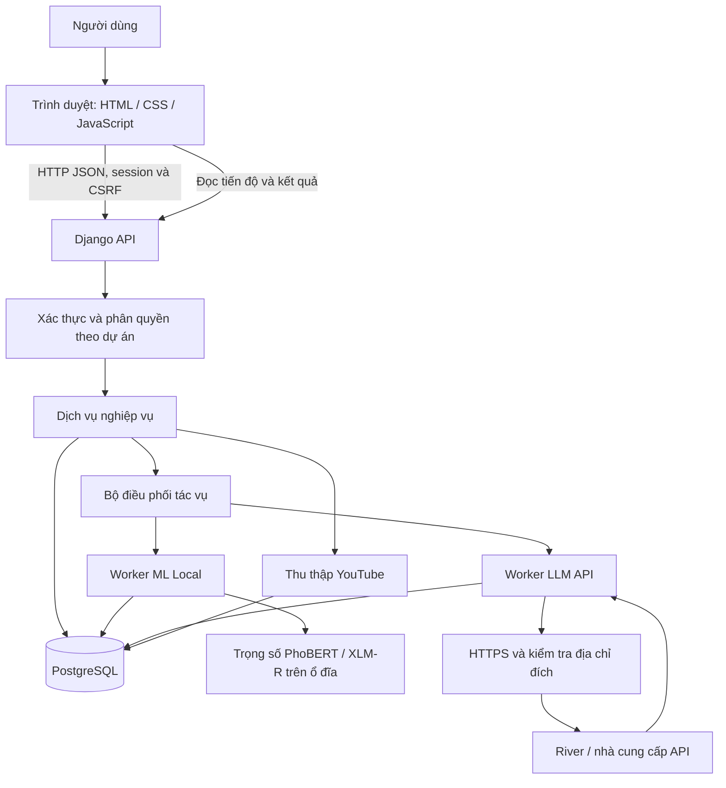
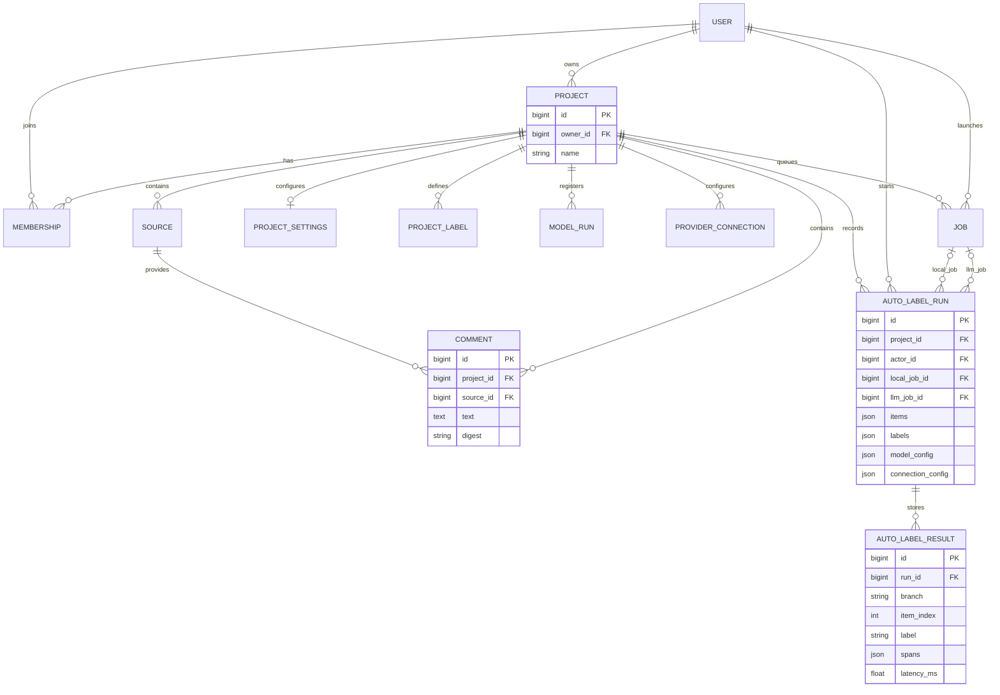
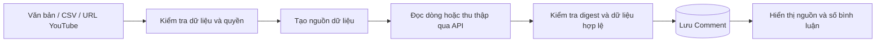
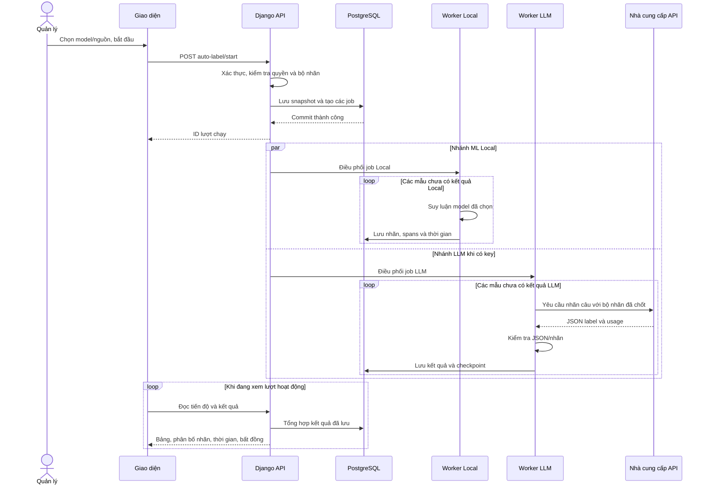
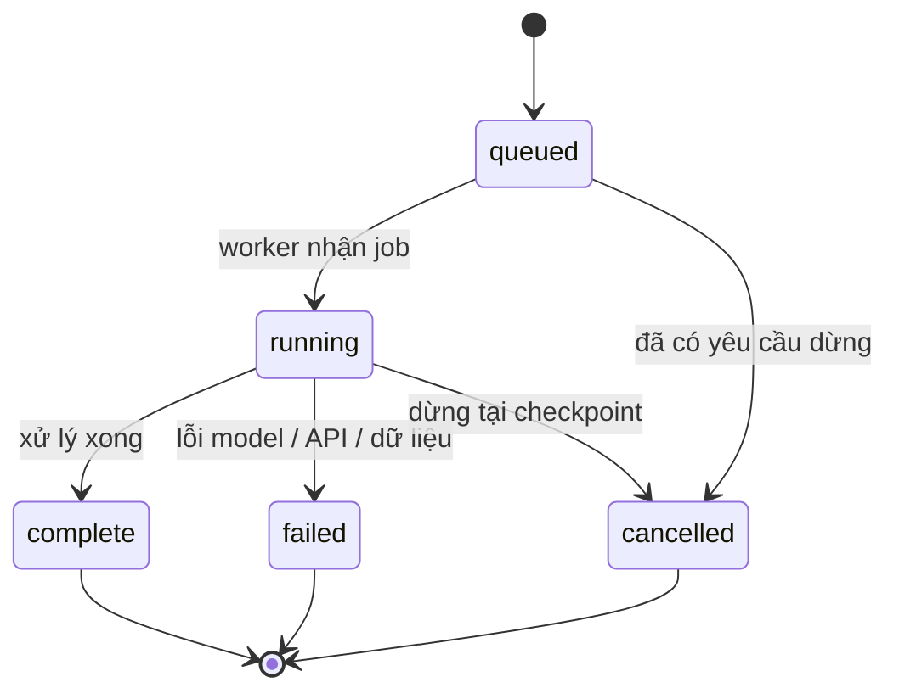

# PHÂN TÍCH VÀ THIẾT KẾ HỆ THỐNG ANNOTAFLOW

**Đề tài:** Website tự động gán nhãn bình luận tiếng Việt, đối chiếu ML Local và LLM qua API.
**Phiên bản mô tả:** Nhánh `huong-moi`, chức năng đã triển khai trong mã nguồn hiện tại.
**Công nghệ chính:** HTML/CSS/JavaScript ES modules, Django, PostgreSQL, PyTorch/Transformers.
**Mục đích tài liệu:** Giải thích cấu trúc mã nguồn, phân tích nghiệp vụ và thiết kế kiến trúc, dữ liệu, xử lý, giao diện và bảo mật cho báo cáo đồ án.

> Tài liệu phân biệt chức năng hiện có và định hướng phát triển. Các sơ đồ dùng Mermaid; có thể xem trên GitHub hoặc trình xem hỗ trợ Mermaid. Các số lượng dự án/bình luận thực tế không được cố định trong tài liệu vì thay đổi khi sử dụng.

## 1. Tổng quan đề tài

### 1.1. Bài toán

Bình luận tiếng Việt được thu thập từ YouTube hoặc nhập từ tệp/văn bản cần được phân loại theo bộ nhãn thống nhất. Gán thủ công từng bình luận mất thời gian; chỉ dùng một mô hình khó quan sát những trường hợp còn bất đồng.

AnnotaFlow tổ chức quá trình tự gán nhãn thành các lượt độc lập. Mỗi lượt sử dụng một mô hình ML Local đã chọn và, khi có kết nối API phù hợp, chạy thêm LLM trên cùng tập bình luận. Hệ thống lưu kết quả từng nhánh, tổng hợp tỷ lệ nhãn, đo thời gian và chỉ ra các bình luận khác nhãn để người dùng xem lại.

### 1.2. Mục tiêu

1. Quản lý tài khoản, dự án, nguồn dữ liệu và bộ nhãn.
2. Nhập bình luận từ văn bản, CSV và YouTube.
3. Chạy ML Local mà không cần key của nhà cung cấp LLM.
4. Khi có API key, chạy thêm LLM độc lập trên cùng dữ liệu và bộ nhãn.
5. Lưu kết quả, hiển thị biểu đồ phân bố nhãn và thời gian từng nhánh.
6. Lọc bình luận có nhãn khác nhau và xuất kết quả CSV.
7. Quản lý cấu hình API bằng backend, mã hóa key và kiểm tra kết nối an toàn.

### 1.3. Phạm vi hiện tại

| Thành phần | Phạm vi triển khai |
|---|---|
| ML Local | Chọn một trong PhoBERT-base, XLM-R base hoặc XLM-R large cho mỗi lượt |
| LLM | Kết nối từ backend tới nhà cung cấp; River DeepSeek-V4.1-Flash là cấu hình đang được sử dụng |
| Bộ nhãn mặc định | `NON_TOXIC` — Không độc hại; `TOXIC` — Độc hại |
| So sánh | Khác biệt nhãn câu giữa hai nhánh; chưa tự kết luận nhánh nào đúng |
| Kết quả | Danh sách, biểu đồ tròn, tiến độ, thời gian, xuất CSV |
| Gán thủ công | Tạm bỏ khỏi giao diện chính; mã và dữ liệu lịch sử vẫn được giữ |
| Môi trường chính | Windows chạy Django tại localhost và PostgreSQL cục bộ |
| Môi trường khác | Có cấu hình Docker/Celery/Redis; không đồng nghĩa đã kiểm chứng tải production |

**Lưu ý về model:** Ba bộ trọng số hiện tại được nhập từ `vihos-models-full.zip` trên Drive. Hệ thống đã kiểm tra nạp trọng số và suy luận. Điều này không chứng minh ba model được huấn luyện trên máy đang chạy website. Dataset và mã train gốc đã được bổ sung từ ba ZIP do người dùng cung cấp, tại `datasets/ViHOS/`, `training/` và `notebooks/training/`. Notebook nhập chưa có output thực thi; log gắn với một commit chỉ được tạo khi thực sự chạy wrapper mới. Xem `docs/HUONG_DAN_TICH_HOP_DATASET_VA_MINH_CHUNG_TRAIN.md`.

## 2. Phân tích tác nhân và yêu cầu

### 2.1. Tác nhân

| Tác nhân | Vai trò |
|---|---|
| Khách chưa đăng nhập | Đăng ký, đăng nhập và thực hiện luồng khôi phục tài khoản |
| Thành viên dự án | Truy cập dữ liệu và xem kết quả trong dự án được tham gia |
| Quản lý dự án | Nhập dữ liệu, cấu hình model/API, bắt đầu/dừng/tiếp tục tác vụ và quản lý dự án theo quyền |
| Chủ dự án | Có quyền quản lý và quyền xóa vĩnh viễn dự án sau xác nhận |
| Nhà cung cấp LLM | Nhận yêu cầu phân loại, trả nhãn và thông tin sử dụng token |
| YouTube Data API | Cung cấp bình luận và phản hồi của video khi đã có key phù hợp |

Quyền ứng dụng được xác định theo `Project.owner` và `Membership.role`; không dựa vào vai trò do frontend gửi lên. Quyền quản trị dự án không đồng nghĩa bắt buộc phải là tài khoản Django superuser.

### 2.2. Yêu cầu chức năng

| Mã | Chức năng | Kết quả mong đợi |
|---|---|---|
| FR01 | Xác thực người dùng | Có phiên đăng nhập hợp lệ trước khi dùng API nghiệp vụ |
| FR02 | Quản lý dự án và thành viên | Dữ liệu và quyền truy cập được tách theo dự án |
| FR03 | Nhập văn bản/CSV | Tạo nguồn, lưu bình luận và xử lý trùng trong dự án |
| FR04 | Thu thập YouTube | Lưu bình luận, nguồn, metadata và tiến độ thu thập |
| FR05 | Chọn ML Local | Chỉ sử dụng model thuộc dự án và có trạng thái sẵn sàng |
| FR06 | Quản lý nhà cung cấp API | Thêm/sửa, chọn model mặc định, bật/tắt và xóa cấu hình tùy chỉnh |
| FR07 | Kiểm tra kết nối | Xác minh qua metadata, không tự gọi sinh nội dung |
| FR08 | Tự gán một hoặc hai nhánh | Local luôn được tạo; LLM được tạo khi có kết nối API đủ điều kiện |
| FR09 | Theo dõi tác vụ | Hiển thị trạng thái, số mẫu đã xử lý và tiến độ từng nhánh |
| FR10 | Thống kê kết quả | Hiển thị số lượng và phần trăm mỗi nhãn bằng biểu đồ tròn |
| FR11 | So sánh hai nhánh | Tính trên các bình luận đã có đủ hai kết quả |
| FR12 | Đo thời gian | Hiển thị tổng thời gian xử lý và trung bình từng bình luận |
| FR13 | Dừng/tiếp tục | Giữ các kết quả đã lưu; tiếp tục những mẫu còn thiếu |
| FR14 | Xuất dữ liệu | Tải CSV gồm văn bản, nhãn hai bên, thời gian và trạng thái khác nhau |
| FR15 | Xuất cấu hình | Xem/tải JSON theo danh sách trường cho phép, không chứa API key |
| FR16 | Xóa dự án | Chỉ chủ dự án, xác nhận đúng tên và không có tác vụ đang chạy |

### 2.3. Yêu cầu phi chức năng

| Nhóm | Yêu cầu thiết kế |
|---|---|
| Bảo mật | Session, CSRF, kiểm tra quyền ở backend, mã hóa key và chống SSRF |
| Toàn vẹn dữ liệu | Giao dịch database; ràng buộc duy nhất cho kết quả mỗi mẫu/nhánh |
| Khả năng theo dõi | Trạng thái job, checkpoint, cấu hình và dữ liệu được chốt theo từng lượt |
| Khả năng sử dụng | Giao diện tiếng Việt, trạng thái rõ ràng, hỗ trợ màn hình điện thoại |
| Khả năng bảo trì | Tách frontend, API, nghiệp vụ, model dữ liệu và adapter nhà cung cấp |
| Khả năng kiểm thử | Có test nghiệp vụ, quyền, bảo mật, tác vụ và kết quả; CI PostgreSQL 15–18 |
| Hiệu năng | Tác vụ dài chạy nền; API HTTP trả quyền điều khiển lại cho giao diện |

Các yêu cầu trên là cơ chế đã triển khai hoặc mục tiêu thiết kế; không phải cam kết về số người dùng đồng thời hay độ trễ production đã đo.

### 2.4. Quy tắc nghiệp vụ

1. Người dùng chỉ truy cập dự án có tư cách thành viên; thao tác quản lý cần đúng quyền.
2. Dự án khóa/lưu trữ không được bắt đầu lượt gán nhãn mới.
3. Chỉ tạo một lượt tự gán nhãn đang hoạt động trong cùng dự án tại một thời điểm.
4. Bộ nhãn đang bật của dự án phải khớp chính xác bộ nhãn mà ML Local hỗ trợ.
5. Một lượt chốt văn bản, ID, nguồn, bộ nhãn và cấu hình; dữ liệu nhập thêm thuộc lượt mới.
6. LLM và ML Local dùng cùng tập đầu vào; số kết quả tạm thời có thể khác vì tốc độ hoặc lỗi.
7. Kết quả API phải là JSON và nhãn phải thuộc bộ nhãn của lượt; không tạo nhãn thay thế khi API lỗi.
8. LLM trong luồng tự động chỉ được yêu cầu nhãn câu; không phụ thuộc offsets cụm từ.
9. Lỗi một nhánh không tự hủy nhánh còn lại.
10. Không tính mẫu còn thiếu một nhánh là bất đồng.
11. Nhà cung cấp tích hợp sẵn không được xóa; nhà cung cấp tùy chỉnh cần xác nhận tên khi xóa.
12. Cấu hình API/trọng số thay đổi sau checkpoint cần tạo lượt mới nếu không còn khớp điều kiện đã chốt.

## 3. Kiến trúc tổng thể

### 3.1. Kiến trúc phân lớp

Hệ thống sử dụng backend Django dạng ứng dụng nguyên khối được chia module. Frontend là ứng dụng JavaScript ES modules, điều hướng bằng URL hash như `#annotation`, không sử dụng React hoặc Vue.



### 3.2. Trách nhiệm từng lớp

| Lớp | Trách nhiệm | Vị trí mã |
|---|---|---|
| Trình bày | Hiển thị, nhập liệu, modal, biểu đồ và điều hướng | `frontend/src/` |
| API | Đọc request, xác thực, kiểm tra quyền, trả JSON/CSV | `backend/core/api/`, `backend/studio/api/` |
| Nghiệp vụ | Bộ nhãn, lựa chọn model/API, tạo lượt, thống kê và xuất dữ liệu | Các thư mục `services/`, API nghiệp vụ và job |
| Tác vụ | Chạy xử lý dài, lưu tiến độ, kết quả và checkpoint | `backend/core/jobs/` |
| Tích hợp | Giao tiếp nhà cung cấp, mã hóa key, kiểm tra metadata và SSRF | `backend/integrations/` |
| Lưu trữ | Django ORM, các bảng và migrations | Các file/thư mục `models` và PostgreSQL |

### 3.3. Cách triển khai hiện tại

Ở chế độ Windows native, Django phục vụ ứng dụng trên `127.0.0.1:8000`; PostgreSQL cục bộ sử dụng cổng 5432. Tác vụ nền dùng `ThreadPoolExecutor(max_workers=2)` trong tiến trình Python.

Hai job Local/LLM được tạo độc lập, đưa vào pool sau khi giao dịch tạo lượt đã commit. Khi hai worker sẵn sàng, chúng có thể xử lý đồng thời. Nếu worker đang bận tác vụ khác, job mới phải chờ. Đây là thực thi song song ở cấp nhánh, không phải xử lý tất cả bình luận cùng lúc.

Trong phương án Docker có dịch vụ web, worker Celery, Redis và PostgreSQL. PostgreSQL trong Compose hiện dùng image 15; môi trường native hiện dùng PostgreSQL 18. Không nhầm volume database Docker với thư mục database native.

## 4. Cấu trúc mã nguồn

```text
AnnotaFlow/
├── backend/
│   ├── config/                    Cấu hình Django, URLs, WSGI, Celery
│   ├── core/
│   │   ├── api/                   Tài khoản, dự án, nhập liệu, suy luận
│   │   ├── jobs/                  Worker và các tác vụ nền
│   │   ├── services/              Điều phối job, nạp và đăng ký model
│   │   ├── management/commands/   Migrate/setup/demo/recovery/kiểm tra model
│   │   ├── migrations/            Lịch sử cấu trúc các bảng lõi
│   │   └── models.py              Project, Source, Comment, Job...
│   ├── studio/
│   │   ├── api/                   API chức năng giao diện
│   │   ├── models/                Cài đặt, nhãn, lượt/kết quả tự động...
│   │   ├── services/              Quy tắc dự án, xuất dữ liệu, phiên bản
│   │   └── migrations/
│   ├── integrations/
│   │   ├── providers/             Adapter OpenAI-compatible/Gemini/Ollama
│   │   ├── provider_settings.py   Kiểm tra metadata và trạng thái cấu hình
│   │   ├── secure_http.py         Kiểm tra DNS/IP, ghim IP, TLS
│   │   ├── secrets.py             Mã hóa/giải mã API key
│   │   ├── registry.py            Giao diện gọi adapter và chụp cấu hình
│   │   └── models.py              ProviderConnection
│   ├── experiments/               ModelRun, báo cáo, thí nghiệm TF-IDF
│   ├── reviewing/                 Luồng kiểm tra/phân xử cũ
│   ├── artifacts/transformers/vihos-full/
│   │   ├── phobert-base/
│   │   ├── xlmr-base/
│   │   └── xlmr-large/
│   ├── private_data/              Database/file runtime riêng, không lên Git
│   ├── tests/                     Kiểm thử tự động
│   └── manage.py                  Điểm vào lệnh quản trị Django
├── datasets/ViHOS/                 Dataset train/dev/test gốc từ ZIP
├── training/                      Mã train, cấu hình và bằng chứng chạy
├── notebooks/training/            Notebook Colab nguyên bản chưa có output
├── frontend/
│   ├── index.html
│   ├── public/                    Tài nguyên tĩnh và báo cáo cho demo
│   └── src/
│       ├── app.js                 Khởi động, shell, router và sự kiện
│       ├── core/                  API client, state, UI dùng chung
│       ├── features/              Các màn hình nghiệp vụ
│       └── styles/                CSS, giao diện tự động và cài đặt dark
├── dist/                          Giao diện được sinh từ frontend
├── scripts/                       Cài đặt, build và khởi động
├── requirements/                  Thư viện Python cơ bản/Windows/Transformer
├── docs/                          Tài liệu và SQL trình bày dữ liệu
├── .github/workflows/tests.yml    CI PostgreSQL 15, 16, 17, 18
├── RUN_NATIVE_WINDOWS.bat         Chạy trên Windows
├── Dockerfile
├── docker-compose.yml
├── .env.example                   Mẫu cấu hình không có bí mật thực tế
└── .env.local                     Cấu hình riêng trên máy, không đưa lên Git
```

`frontend/` là nơi chỉnh giao diện; `scripts/build_frontend.py` sao chép tài nguyên sang `dist/` và thêm mã phiên bản vào URL CSS/JS để cập nhật cache. Thay đổi trực tiếp trong `dist/` có thể bị ghi đè khi build.

Các thư mục `.venv/`, `.publish/`, `__pycache__/` lần lượt là môi trường Python, dữ liệu kiểm tra tạm và cache Python. Chúng không phải các module nghiệp vụ.

## 5. Thiết kế cơ sở dữ liệu

### 5.1. Nguyên tắc

Các dữ liệu chính được lưu trong PostgreSQL bằng Django ORM. Mỗi đối tượng nghiệp vụ gắn với dự án để kiểm tra quyền và phân tách dữ liệu.

Quan hệ ổn định như dự án–nguồn–bình luận dùng khóa ngoại. Đầu vào và cấu hình của một lượt tự gán nhãn được lưu dạng JSON snapshot để kết quả cũ không thay đổi khi nguồn hoặc cấu hình hiện tại được chỉnh sửa.

### 5.2. Các bảng trọng tâm

| Bảng | Ý nghĩa | Trường chính |
|---|---|---|
| `auth_user` | Tài khoản Django | `id`, `username`, mật khẩu đã băm |
| `core_project` | Dự án | `id`, `name`, `description`, `owner_id` |
| `core_membership` | Thành viên dự án | `project_id`, `user_id`, `role` |
| `core_source` | Nguồn dữ liệu | `project_id`, `name`, `kind`, `external_id`, `metadata`, `checkpoint` |
| `core_comment` | Bình luận | `project_id`, `source_id`, `text`, `original_text`, `digest`, `unusable` |
| `studio_projectsettings` | Cấu hình dự án | `project_id`, `locked`, `archived`, `active_model_id`, `active_connection_id` |
| `studio_projectlabel` | Bộ nhãn | `project_id`, `key`, `name`, `color`, `enabled`, `order` |
| `experiments_modelrun` | Model đã đăng ký | `project_id`, `name`, `algorithm`, `state`, `artifact_path`, `report` |
| `integrations_providerconnection` | Nhà cung cấp API | URL, model, danh sách model, key mã hóa, bật/tắt, trạng thái kiểm tra |
| `core_job` | Tác vụ nền | `project_id`, `actor_id`, `kind`, `status`, `progress`, `payload`, `checkpoint`, `result` |
| `studio_autolabelrun` | Lượt tự gán nhãn | `project_id`, `actor_id`, `items`, `labels`, `model_config`, `connection_config`, hai job |
| `studio_autolabelresult` | Kết quả từng mẫu/nhánh | `run_id`, `branch`, `item_index`, `label`, `spans`, `latency_ms`, token và chi phí ước tính |
| `core_auditevent` | Nhật ký nghiệp vụ | `project_id`, `actor_id`, `action`, `detail`, `created_at` |

Các bảng nhãn người, gold, phiên bản dữ liệu và review vẫn tồn tại cho lịch sử; không phải luồng gán nhãn chính trên giao diện hiện tại.

### 5.3. Sơ đồ quan hệ rút gọn



`USER` trong sơ đồ là bảng `auth_user`. Sơ đồ chỉ thể hiện các quan hệ chính. `ProjectSettings` còn có khóa ngoại lựa chọn model và nhà cung cấp hiện hành.

### 5.4. Snapshot và cách ghép kết quả

`AutoLabelRun.items` là danh sách JSON, ví dụ minh họa:

```json
[
  {"id": 101, "text": "Bình luận minh họa", "source": "Nguồn A"},
  {"id": 102, "text": "Một bình luận khác", "source": "Nguồn A"}
]
```

`AutoLabelResult.item_index` trỏ đến vị trí trong danh sách trên, bắt đầu từ 0. Hai kết quả cùng `(run_id, item_index)` và khác `branch` là hai đánh giá của cùng một mẫu.

**Đây là liên kết logic vào snapshot JSON, không phải khóa ngoại từ kết quả tới `Comment`.** ID bình luận trong snapshot được dùng để truy vết. Kết quả cũ vẫn giữ văn bản lúc chạy ngay cả khi bình luận gốc được sửa hoặc nguồn bị xóa.

### 5.5. Ràng buộc dữ liệu

| Ràng buộc | Mục đích |
|---|---|
| Duy nhất `(project, user)` ở Membership | Không tạo lặp thành viên |
| Duy nhất `(project, digest)` ở Comment | Tránh lưu trùng bình luận theo digest |
| Duy nhất `(project, key)` ở ProjectLabel | Mỗi key nhãn chỉ có một định nghĩa trong dự án |
| Duy nhất `(run, branch, item_index)` ở AutoLabelResult | Không lưu trùng kết quả khi tiếp tục job |
| Duy nhất `(project, builtin_key)` khi key tích hợp không rỗng | Không tạo lặp nhà cung cấp tích hợp sẵn |
| Khóa ngoại và giao dịch | Đảm bảo quan hệ và cập nhật nhất quán |

## 6. Thiết kế mô hình và bộ nhãn

### 6.1. Ba model Local

| Model | Thư mục trọng số |
|---|---|
| PhoBERT-base | `backend/artifacts/transformers/vihos-full/phobert-base/` |
| XLM-R base | `backend/artifacts/transformers/vihos-full/xlmr-base/` |
| XLM-R large | `backend/artifacts/transformers/vihos-full/xlmr-large/` |

Các model dùng bộ nhãn token BIO `O`, `B-T`, `I-T`. Adapter chia văn bản theo âm tiết/khoảng trắng, sử dụng dự đoán token con đầu tiên và giữ vị trí trong văn bản gốc. Văn bản dài được chia thành cửa sổ trong giới hạn model.

Nhãn câu của ML Local được suy ra:

```text
Có ít nhất một span độc hại  → TOXIC
Không có span độc hại        → NON_TOXIC
```

Do đó, nhãn câu suy ra từ Local và nhãn câu do LLM trả về có thể được so sánh theo cùng danh mục. Điều này không có nghĩa hai bên có cùng cơ chế suy luận hoặc F1 span có thể đổi trực tiếp thành accuracy nhãn câu.

### 6.2. Nạp model

Backend nạp tokenizer/trọng số cục bộ, yêu cầu định dạng safetensors và không cho chạy mã tùy chỉnh từ model. Có kiểm tra sự khớp cấu hình/trọng số, bộ nhãn BIO và đường dẫn model hợp lệ.

Bộ nạp chỉ giữ một Transformer trong RAM tại một thời điểm, dùng khóa khi suy luận để tránh đổi model đồng thời trong cùng tiến trình. Cache được nhận diện theo đường dẫn và metadata file. Chuyển model có thể phát sinh thời gian nạp lại. Số luồng CPU mặc định là 4, có thể cấu hình bằng `TRANSFORMER_CPU_THREADS`.

### 6.3. LLM API

Luồng tự động gửi văn bản và bộ nhãn đã chốt, yêu cầu JSON chứa một nhãn câu hợp lệ. Key chỉ được giải mã tại backend khi cần gọi nhà cung cấp.

Ví dụ cấu trúc kết quả cần thiết:

```json
{"label": "NON_TOXIC"}
```

Đối với luồng này, không yêu cầu LLM tính vị trí cụm từ. Những chức năng riêng có sử dụng spans vẫn giữ kiểm tra offsets, thứ tự và chồng lấn; không bỏ kiểm tra toàn hệ thống.

### 6.4. Báo cáo model

`metrics.json` lưu các tham số, lịch sử epoch và chỉ số được cung cấp theo bộ model. `verified.json` lưu kiểm tra suy luận và hash artifact trên máy. `docs/model-bundle.json` ghi nguồn bộ model và thông tin xác minh.

Không sử dụng báo cáo span được cung cấp để khẳng định accuracy của website trên bình luận YouTube mới. Muốn đo độ chính xác cần có tập tham chiếu độc lập và quy trình đánh giá riêng.

## 7. Thiết kế luồng xử lý

### 7.1. Nhập dữ liệu



Nhập văn bản được tách theo dòng. CSV có thể thiết lập cột dữ liệu. Thu thập YouTube sử dụng job nền và checkpoint phân trang; key YouTube là cấu hình riêng, không dùng key River.

### 7.2. Bắt đầu tự gán nhãn

1. Giao diện gửi dự án, model và phạm vi nguồn tới backend.
2. Backend xác thực người dùng, kiểm tra quyền quản lý và trạng thái dự án.
3. Kiểm tra không có lượt tự gán khác đang chờ/chạy trong dự án.
4. Kiểm tra model sẵn sàng và bộ nhãn khớp chính xác.
5. Lấy các bình luận không bị đánh dấu không sử dụng trong phạm vi đã chọn.
6. Chốt `items`, `labels`, `model_config` và `connection_config` vào `AutoLabelRun`.
7. Tạo job `local`; tạo thêm job `llm` nếu có API đủ điều kiện.
8. Commit giao dịch rồi điều phối các job; trả ID lượt chạy cho frontend.

Khi chọn kết nối API, hệ thống ưu tiên kết nối đang chọn nếu đang bật và có key; nếu không, chọn kết nối đủ điều kiện đầu tiên trong dự án. Luồng tự động hiện loại Ollama khỏi lựa chọn API này. Không có kết nối đủ điều kiện thì chỉ tạo Local.

### 7.3. Sơ đồ tuần tự hai nhánh



Các lời gọi điều phối thực tế đi qua `core/services/jobs.py`; sơ đồ rút gọn vai trò bộ điều phối để tập trung vào luồng nghiệp vụ.

### 7.4. Xử lý trong một worker

Worker kiểm tra trạng thái, quyền, yêu cầu dừng và cấu hình đã chốt. Local đối chiếu hash artifact; LLM đối chiếu cấu hình kết nối. Sau đó worker lấy tập `item_index` đã có kết quả và bỏ qua các mẫu này.

Với mỗi mẫu còn thiếu: kiểm tra checkpoint → suy luận/gọi API → kiểm tra kết quả → lưu bằng giao dịch → cập nhật tiến độ và thời gian. Kết quả nhận thành công được lưu trước checkpoint hủy tiếp theo để giảm mất kết quả đã gọi API.

### 7.5. Trạng thái tác vụ



Khi tiếp tục, hệ thống tạo **job mới** cho cùng lượt và nhánh, sao chép checkpoint rồi cập nhật khóa ngoại `local_job` hoặc `llm_job`. Job cũ được giữ trạng thái lịch sử; không chuyển trực tiếp nó từ `failed` sang `running`.

Nếu cấu hình đã đổi, hệ thống yêu cầu lượt mới. Nếu tiến trình chết sau khi nhà cung cấp đã xử lý nhưng trước khi lưu kết quả, mẫu đó có thể được gọi lại khi tiếp tục; hệ thống không bảo đảm exactly-once cho yêu cầu qua mạng.

### 7.6. Cài đặt và kiểm tra nhà cung cấp

1. Quản lý nhập tên, HTTPS Base URL, API key, danh sách Model ID, model mặc định và trạng thái bật/tắt.
2. Backend kiểm tra trường bắt buộc, model mặc định thuộc danh sách và chính sách URL.
3. Key được mã hóa bằng Fernet trước khi lưu; ô key trống khi sửa giữ khóa đã lưu.
4. Nút kiểm tra gọi backend; backend gửi `GET /models`, không tự tạo completion.
5. Thành công chỉ khi metadata hợp lệ và model mặc định xuất hiện trong danh sách được phép truy cập.
6. Không có endpoint metadata thì giữ trạng thái chưa xác minh và thông báo rõ.
7. Kết quả kiểm tra được lưu; sửa cấu hình liên quan làm mất trạng thái kiểm tra trước đó.

Form chưa lưu có thể kiểm tra cấu hình nháp. Backend cấp bằng chứng ký số có thời hạn, gắn với người dùng/dự án/cấu hình, để lưu đúng kết quả kiểm tra cùng cấu hình. Key nháp không được tự lưu chỉ vì bấm kiểm tra.

## 8. Thiết kế thống kê và so sánh

### 8.1. Phân bố nhãn

Với nhánh `b`, gọi `n_b(l)` là số kết quả nhãn `l`, `N_b` là số mẫu nhánh đó đã xử lý:

```text
Tỷ lệ nhãn l của nhánh b = n_b(l) / N_b × 100%
```

Khi `N_b = 0`, giao diện hiển thị biểu đồ rỗng và 0%, tránh chia cho 0. Hai nhánh luôn dùng cùng danh mục nhãn, kể cả nhãn có số lượng 0.

Khi còn đang chạy hoặc bị lỗi, biểu đồ mỗi nhánh dựa trên số mẫu hoàn thành của chính nhánh đó. Không diễn giải chênh lệch hai biểu đồ trên những tập chưa hoàn thành như một so sánh công bằng toàn bộ dữ liệu.

### 8.2. Bất đồng

```text
P = tập mẫu đã có cả kết quả Local và LLM
D = tập mẫu trong P có nhãn Local khác nhãn LLM

Tỷ lệ bất đồng = |D| / |P| × 100%
```

Bộ lọc “Chỉ xem nhãn khác nhau” hiển thị `D`. Mẫu chưa có đủ hai kết quả không được tính là cùng nhãn hoặc khác nhãn. Tỷ lệ bất đồng không phải error rate vì chưa có nhãn tham chiếu xác định bên nào đúng.

### 8.3. Thời gian

Thời gian được đo bằng đồng hồ đơn điệu `time.perf_counter()` trong từng worker:

```text
T_b = tổng thời gian worker hoạt động của nhánh b qua các lần chạy/tiếp tục
Trung bình nhánh b = T_b / số kết quả nhánh b đã lưu
Tỷ lệ thời gian LLM/Local = T_llm / T_local
```

`T_b` gồm chuẩn bị/kiểm tra model hoặc API, xử lý và lưu kết quả. Không cộng chờ hàng đợi hoặc thời gian dừng giữa hai lần tiếp tục. Kết quả từng mẫu còn có `latency_ms` riêng; tổng các latency này có thể khác tổng thời gian nhánh do chi phí chuẩn bị và checkpoint.

Chỉ hiển thị tỷ lệ tổng thời gian khi hai nhánh đều hoàn tất cùng tập dữ liệu. Thời gian Local phụ thuộc CPU/RAM/cache; thời gian LLM còn phụ thuộc mạng và máy chủ nhà cung cấp. Đây là so sánh thời gian vận hành thực tế của lượt, không phải phép đo tốc độ phần cứng thuần túy.

### 8.4. Token và chi phí

Worker lưu usage do API trả về. Chi phí được ước tính theo giá input/output đã cấu hình; giá 0 nghĩa chưa cấu hình ước tính, không chứng minh API miễn phí. Kết quả ước tính không thay thế hóa đơn/hạn mức trên tài khoản nhà cung cấp.

## 9. Thiết kế API

Các đường dẫn sau tương đối với máy chủ Django. API nghiệp vụ dùng phiên đăng nhập; POST được bảo vệ CSRF.

| Phương thức | Endpoint | Công dụng |
|---|---|---|
| GET | `/api/session` | Kiểm tra phiên đăng nhập |
| GET | `/api/bootstrap` | Lấy trạng thái dự án và dữ liệu ban đầu cho giao diện |
| POST | `/api/projects` | Tạo dự án |
| POST | `/api/import` | Nhập văn bản/CSV theo luồng lõi |
| POST | `/api/youtube` | Tạo nguồn và job thu thập YouTube |
| POST | `/api/studio/import-csv` | Nhập CSV có mapping bằng job |
| GET | `/api/studio/comments` | Danh sách bình luận |
| GET | `/api/studio/auto-label/runs` | Lịch sử và tóm tắt lượt tự động |
| POST | `/api/studio/auto-label/start` | Tạo snapshot và các job của lượt |
| GET | `/api/studio/auto-label/runs/{id}` | Kết quả, thống kê, lọc và phân trang |
| GET | `/api/studio/auto-label/runs/{id}?download=csv` | Xuất kết quả hai nhánh |
| POST | `/api/studio/auto-label/runs/{id}/control` | Dừng hoặc tiếp tục từng nhánh |
| GET | `/api/studio/connections` | Cấu hình nhà cung cấp dành cho quản lý |
| POST | `/api/studio/connections/save` | Lưu cấu hình/key đã mã hóa |
| POST | `/api/studio/connections/test` | Kiểm tra metadata, không sinh nội dung |
| POST | `/api/studio/connections/delete` | Xóa nhà cung cấp tùy chỉnh sau xác nhận |
| GET | `/api/studio/connections/configuration` | JSON cấu hình không chứa bí mật |
| POST | `/api/studio/selection` | Chọn model Local hoặc nhà cung cấp mặc định |
| POST | `/api/studio/project-settings` | Sửa dự án hoặc xóa theo action và quyền chủ |

Ví dụ tạo lượt:

```json
{
  "project": 1,
  "model_id": 10,
  "source_id": 3
}
```

Các ID chỉ minh họa, phải dùng ID thực tế của dự án hiện tại. Bỏ phạm vi nguồn thì lấy các nguồn trong dự án theo logic API. Request không chứa API key; key được lấy từ cấu hình đã lưu trên backend.

## 10. Thiết kế giao diện

### 10.1. Các màn hình chính

| Màn hình | Nội dung |
|---|---|
| Đăng nhập/tài khoản | Session, hồ sơ, mật khẩu, thiết lập YouTube |
| Dự án | Tạo, chọn, xem dự án và nút xóa dành cho chủ |
| Tổng quan | Tiến độ Local của lượt gần nhất và các bước thao tác |
| Dữ liệu | Nhập văn bản/CSV/YouTube, nguồn, bình luận và job thu thập |
| Gán nhãn tự động | Chọn model/nguồn, theo dõi một/hai nhánh, biểu đồ, thời gian, kết quả và bộ lọc bất đồng |
| Xuất dữ liệu | Tải CSV theo từng lượt |
| Mô hình & API | Danh sách nhà cung cấp dark theme, model mặc định, modal cấu hình và xem JSON |
| Cài đặt dự án | Thông tin, bộ nhãn, khóa/lưu trữ và xóa dự án |

### 10.2. Trạng thái trên giao diện

- Job phân biệt đang chờ, đang chạy, hoàn tất, thất bại và đã dừng.
- Mẫu chưa có kết quả hiển thị “Chưa có kết quả”, không gán mặc định thành nhãn âm.
- Nhà cung cấp: xám khi chưa kiểm tra/đang tắt, xanh khi xác minh metadata thành công, đỏ khi kiểm tra thất bại.
- Form sửa không trả lại key; ô trống có nghĩa giữ key cũ.
- Dự án và nhà cung cấp đều cần xác nhận khi xóa.
- Bảng kết quả phân trang; màn hình nhỏ xếp các thẻ theo chiều dọc.

Sidebar trong trang Mô hình & API gồm Chung, Mô hình, Plugin tích hợp và Cấu hình agent. Mục Mô hình được triển khai đầy đủ; các mục còn lại dẫn đến trang tài khoản/cấu hình dự án hiện có, không có hệ thống plugin/agent mới được giả lập.

## 11. Thiết kế bảo mật

### 11.1. Xác thực và phân quyền

Django quản lý tài khoản và mật khẩu băm; đăng nhập dùng session cookie. API kiểm tra đăng nhập, membership, quyền manager/chủ và dự án được yêu cầu. Chỉ ẩn nút ở frontend là chưa đủ, do đó quyền được kiểm tra lại tại backend.

### 11.2. API key

Key được mã hóa Fernet trong PostgreSQL bằng cơ chế dẫn xuất khóa từ secret của ứng dụng. Key được giải mã ở server khi gọi nhà cung cấp. Response cấu hình chỉ có cờ `key_configured`, không có khóa rõ hoặc ciphertext. JSON xuất dùng danh sách trường cho phép.

Không lưu key trong localStorage hoặc bundle. Khi đổi `DJANGO_SECRET_KEY`, cần có kế hoạch chuyển khóa; ciphertext cũ có thể không giải mã được. Bản backup database và cấu hình giải mã phải được bảo vệ riêng.

### 11.3. SSRF và giao tiếp mạng

Kết nối API từ xa yêu cầu HTTPS cổng 443 và URL không chứa tài khoản, query hoặc fragment. Địa chỉ loopback/private/link-local/metadata và hostname nội bộ bị chặn.

Trước khi gửi, backend phân giải DNS và kiểm tra mọi IP trả về. Transport kết nối đến IP đã kiểm tra, đồng thời giữ Host và TLS SNI của hostname gốc; không phân giải lại hostname để chọn đích kết nối. Request không tự theo chuyển hướng và không dùng proxy môi trường để đi vòng cơ chế này.

Ollama nội bộ là cấu hình cũ được quản trị thiết lập, được giữ riêng; giao diện không cho tạo kết nối nội bộ mới hoặc đổi endpoint nội bộ cũ.

### 11.4. Dữ liệu và đầu ra

- Nhãn API được kiểm tra với bộ nhãn đã chốt; JSON không hợp lệ gây lỗi rõ ràng.
- Văn bản hiển thị được escape; văn bản đầu vào được đưa vào prompt như dữ liệu.
- CSV xử lý các giá trị có nguy cơ bị ứng dụng bảng tính diễn giải thành công thức.
- Kiểm tra model path và không chấp nhận tùy ý artifact thực thi do người dùng tải lên.
- Lỗi kết nối không trả nguyên response/header chứa thông tin nhạy cảm về frontend.

Các cơ chế prompt và kiểm tra JSON không chứng minh đã loại bỏ hoàn toàn prompt injection hoặc mọi sai sót nội dung của LLM.

## 12. Lưu trữ, khởi động và vận hành

### 12.1. Vị trí dữ liệu

| Loại | Nơi lưu |
|---|---|
| Dữ liệu ứng dụng | Database PostgreSQL `annotaflow` trong cấu hình local |
| File PostgreSQL native trên máy hiện tại | `backend/private_data/postgres18/` |
| Trọng số và tokenizer | `backend/artifacts/transformers/vihos-full/` |
| CSV nhập qua upload | Có thể được tạo dưới `backend/private_data/uploads/` khi sử dụng |
| File xuất | `backend/private_data/exports/` theo luồng xuất lưu file; CSV tự động cũng có thể trả trực tiếp qua HTTP |
| Email phát triển | `backend/private_data/emails/` |
| Cấu hình riêng | `.env.local`; Docker sử dụng cấu hình `.env` theo script |

Không mở/sửa trực tiếp file database PostgreSQL. Dùng pgAdmin/SQL hoặc Django ORM. File `docs/XEM_CSDL.sql` có các truy vấn chỉ đọc để trình bày dự án, bình luận và nhãn hai nhánh.

### 12.2. Khởi động native

`RUN_NATIVE_WINDOWS.bat` sử dụng Python trong `.venv`, gọi `scripts/bootstrap_native.py`. Quy trình gồm kiểm tra/cài thư viện, chuẩn bị PostgreSQL và cấu hình, migrate, build frontend, chuẩn bị dữ liệu/model đã đăng ký, phục hồi trạng thái job bị ngắt rồi chạy server.

Nếu cổng 8000 đã có server khác, script báo trùng cổng. Cần dùng server đang chạy hoặc dừng đúng tiến trình cũ trước khi khởi động thêm. Không khởi động hai server native cùng xử lý các job của một database mà không có thiết kế worker phù hợp.

### 12.3. Sao lưu và xóa

Sao lưu source trên Git không đồng nghĩa sao lưu database hay trọng số. Cần backup PostgreSQL bằng công cụ phù hợp như `pg_dump`, giữ bộ model ở nơi bàn giao riêng và bảo vệ cấu hình bí mật.

Xóa dự án hiện xóa dữ liệu dự án trong database qua giao dịch, chỉ khi chủ dự án xác nhận đúng tên và không có job đang chạy. Trọng số dùng chung không bị xóa. Dọn các file vật lý phát sinh và chính sách lưu backup cần được quản lý riêng.

## 13. Kiểm thử và đánh giá hệ thống

### 13.1. Các nhóm kiểm thử

| Nhóm | Nội dung chính |
|---|---|
| Tài khoản | Session, đăng ký/đăng nhập, mật khẩu, CSRF |
| Quyền dự án | Thành viên, quản lý, chủ dự án, truy cập chéo dự án |
| Tự động | Không key chỉ Local; có key tạo hai job; đầu vào và nhãn được chốt |
| Song song/phục hồi | Hai worker có thể hoạt động đồng thời; kết quả đã lưu không bị gọi lại |
| Lỗi độc lập | API thất bại không xóa kết quả Local |
| Kết quả | Phân bố nhãn, mẫu có đủ hai kết quả, bất đồng và CSV |
| Nhà cung cấp | Giữ key cũ, mã hóa, trạng thái thật, kiểm tra nháp, mặc định, xóa tích hợp bị chặn |
| Mạng | URL nội bộ, metadata, DNS hỗn hợp, ghim IP/TLS và không chuyển hướng |
| Xóa dự án | Quyền chủ, xác nhận, chặn job đang chạy và bảo toàn dự án khác |
| Model | BIO, Unicode, cấu hình và kiểm tra suy luận riêng với trọng số thật |

### 13.2. Bằng chứng hiện có

Tại bản tính năng được tài liệu hóa, 86 test backend đã chạy thành công. CI kiểm tra PostgreSQL 15, 16, 17 và 18. Giao diện cài đặt đã được kiểm tra bằng trình duyệt, gồm viewport điện thoại 390px. River đã được xác minh thực tế qua `GET /models`.

Phần lớn test tích hợp nhà cung cấp sử dụng response giả lập có kiểm soát để kiểm tra logic, không tạo chi phí API. Điều này khác với status kết nối trên ứng dụng: status thật chỉ được cập nhật qua kiểm tra backend tương ứng.

### 13.3. Phân biệt các loại kết quả

| Nội dung | Ý nghĩa | Không tự chứng minh |
|---|---|---|
| Test phần mềm đạt | Hành vi đã kiểm tra phù hợp mong đợi | Model có độ chính xác cao trên mọi dữ liệu |
| `verified.json` | Model nạp/suy luận được trong các ca thử | Model đã được train trên máy này |
| `metrics.json` | Báo cáo từ bộ model được cung cấp | Điểm đo lại trên dữ liệu YouTube hiện tại |
| Nhãn Local/LLM giống nhau | Hai nhánh đồng ý về nhãn | Nhãn chắc chắn đúng |
| Nhãn khác nhau | Mẫu cần xem xét | Một bên chắc chắn sai |
| Thời gian một lượt | Chi phí thời gian ở điều kiện chạy đó | SLA hoặc kết luận tốc độ trên mọi máy |

## 14. Hạn chế và hướng phát triển

### 14.1. Hạn chế hiện tại

1. Hai worker native phù hợp nhóm nhỏ; đóng tiến trình web ảnh hưởng worker cùng tiến trình.
2. Pool có hai luồng nên job khác có thể khiến nhánh phải chờ.
3. Tập đầu vào được giữ dưới dạng JSON và tổng hợp trong Python; tập rất lớn cần tối ưu lưu trữ, phân trang và truy vấn.
4. Một model Local được chọn cho mỗi lượt, không tự chạy đồng thời cả ba model để so sánh ba chiều.
5. Bộ model BIO hiện hỗ trợ bài toán độc hại nhị phân; thêm nhãn tùy ý không làm model tự học nhãn mới.
6. LLM có thể trả JSON/nhãn sai định dạng hoặc gặp quota/mạng; chưa có chính sách tự retry/backoff đầy đủ cho mọi lỗi.
7. Checkpoint giảm gọi lại nhưng không bảo đảm exactly-once với nhà cung cấp ngoài hệ thống.
8. Chưa có tập gold độc lập cho dữ liệu ứng dụng hiện tại để kết luận accuracy hoặc chất lượng nhãn cuối.
9. Chưa thực hiện kiểm thử tải hoặc benchmark production có quy mô đại diện.
10. Dataset và mã train ba Transformer đã được nhập nguyên bản; chưa có lần full train mới được thực hiện từ wrapper có ghi commit/hash. Notebook lịch sử chưa lưu output thực thi.

### 14.2. Định hướng phát triển

- Chuyển worker sang dịch vụ nền độc lập, bổ sung cơ chế hàng đợi và vận hành rõ ràng.
- Chuẩn hóa item của lượt thành bảng riêng khi kích thước snapshot vượt nhu cầu hiện tại.
- Bổ sung hạn mức API theo lượt, dự toán chi phí và retry có backoff cho lỗi tạm thời.
- Bổ sung nhãn tham chiếu, đánh giá trên cùng tập mẫu và khoảng tin cậy.
- Có thể khôi phục màn hình người duyệt riêng cho mẫu bất đồng nếu yêu cầu nghiệp vụ thay đổi.
- Hoàn thiện pipeline train đã bổ sung: khóa revision model nền, thu thập các lần chạy thật và đánh giá khả năng tái lập qua nhiều môi trường.
- Tự động hóa backup/restore PostgreSQL và kiểm tra quy trình phục hồi.

Những mục này là đề xuất, không được trình bày như chức năng đã hoàn thành.

## 15. Đối chiếu thiết kế với mã nguồn

Các đường dẫn dưới đây tương đối với thư mục dự án:

| Nội dung | Mã nguồn cần đọc |
|---|---|
| Router/shell giao diện | `frontend/src/app.js` |
| Trang tự động và biểu đồ | `frontend/src/features/automatic/index.js` |
| Xuất CSV theo lượt | `frontend/src/features/automatic/exports.js`, `backend/studio/api/automatic.py` |
| Cài đặt Mô hình & API | `frontend/src/features/models/index.js`, `frontend/src/styles/provider-settings.css` |
| Tạo lượt, kết quả và control | `backend/studio/api/automatic.py` |
| Worker hai nhánh | `backend/core/jobs/auto_label.py` |
| Điều phối/thực thi job | `backend/core/services/jobs.py`, `backend/core/jobs/runner.py` |
| Cấu trúc run/result | `backend/studio/models/automatic.py` |
| Model Local | `backend/core/services/transformer_models.py`, `backend/core/services/model_registry.py` |
| Nhà cung cấp/key/metadata | `backend/studio/api/integrations.py`, `backend/integrations/provider_settings.py`, `backend/integrations/secrets.py` |
| Bảo vệ kết nối ngoài | `backend/integrations/secure_http.py` |
| Quyền và trạng thái dự án | `backend/core/api/common.py`, `backend/studio/services/projects.py` |
| Xóa dự án | `backend/studio/api/projects.py` |
| Cấu hình và khởi động | `backend/config/settings.py`, `scripts/bootstrap_native.py`, `RUN_NATIVE_WINDOWS.bat` |
| Kiểm tra tự động | `backend/tests/`, `.github/workflows/tests.yml` |
| Truy vấn trình bày CSDL | `docs/XEM_CSDL.sql` |
| Dataset và pipeline train mới bổ sung | `datasets/ViHOS/`, `training/run_experiment.py`, `training/vihos/` |
| Hướng dẫn minh chứng và đối chiếu train | `docs/HUONG_DAN_TICH_HOP_DATASET_VA_MINH_CHUNG_TRAIN.md` |

## 16. Gợi ý thứ tự trình bày đồ án

1. Nêu bài toán, tác nhân và phạm vi tự gán nhãn.
2. Trình bày kiến trúc frontend–backend–worker–database–nhà cung cấp.
3. Giải thích sơ đồ dữ liệu và việc chốt snapshot cho hai nhánh.
4. Demo nhập bình luận, chọn model và kiểm tra kết nối API.
5. Demo một lượt Local và một lượt có Local/LLM; trình bày biểu đồ, thời gian và bất đồng.
6. Mở pgAdmin với `docs/XEM_CSDL.sql` để đối chiếu dữ liệu đã lưu.
7. Trình bày test, các giới hạn và hướng phát triển.
8. Nếu trình bày huấn luyện model, bổ sung notebook/dataset/log gốc và nói rõ môi trường đã train.

Tài liệu này mô tả phân tích và thiết kế bám theo source hiện tại; có thể dùng làm cơ sở cho chương phân tích thiết kế trong báo cáo, sau khi bổ sung thông tin nhóm, yêu cầu của giảng viên và bằng chứng thực nghiệm của nhóm.
